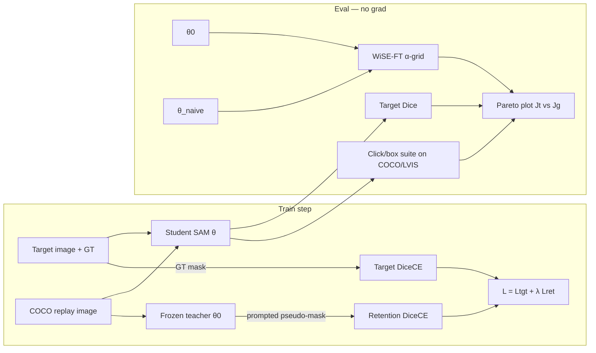

# RetainSAM architecture



```
Weight interpolation (kill-switch baseline):
  θ(α) = (1-α) θ_SAM + α θ_naive

Constraint (what we claim is not equivalent):
  min_θ  L_tgt(θ)  s.t.  J_gen(θ) ≥ J_gen(θ0) - ε
  implemented as replay distillation + optional λ ramp.
```
