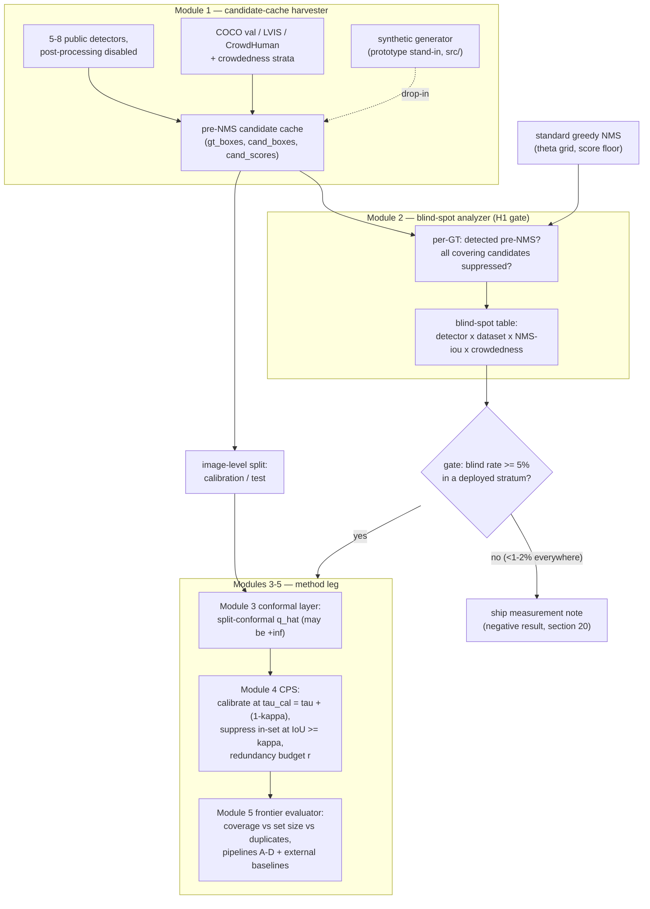

# C-0306 — The NMS Blind Spot: Conformal Coverage Destroyed by Suppression, and Coverage-Preserving Suppression to Restore It

**Full Stage-7 Research Package (draft; awaiting Idea_* numbering by Agent S).**
**Idea ID:** W2-C-0306.
**Pipeline provenance:** Stage-2 D bet #10 (SURVIVE) → Stage-2/3 G LOCK, M mission-protected →
Stage-4 K SURVIVE-IF-EXPERIMENT (blind-spot magnitude is the gate; WACV 2024 baseline mandatory) →
Stage-5 N killer-experiment protocol (`stage5_agent_N/exp_05.md`) → Stage-6 O top-20 #1 / Q top-5 #1
(constructive/method seat; "execute-first") → Stage-7 P synthetic prototype (`stage7_proto_C0306/`)
→ this package (Agent U). PI binding: gravity MUST include ≥1 C idea (this and/or C-0338).

**Epistemic labels used throughout this package:**

- **KNOWN** — established in the literature (real, checkable citation).
- **EVIDENCE** — verified inside this pipeline (e.g., K's fresh prior-work re-search, P's code-level checks).
- **HYPOTHESIS** — pre-registered expectation; not yet measured on real data.
- **MEASURED (synthetic)** — actually produced by the committed prototype at committed seeds, on
  synthetic data generated in-process. **No number in this package is a COCO / LVIS / CrowdHuman
  result. Real-data magnitudes are exactly what the killer experiment exists to measure.**

---

## 1. Executive Summary

Split-conformal calibration on object-detection candidate sets yields a distribution-free guarantee:
with probability ≥ 1−α, each ground-truth (GT) object is covered (IoU ≥ τ) by some member of the
prediction set. Standard greedy non-maximum suppression (NMS) runs *after* scores are produced and can
delete **every** covering candidate of a GT object — the **blind spot**. Objects in the blind spot are
unrecoverable by any downstream threshold, calibration, or conformal layer: the information is gone.
The two existing conformal-object-detection (conformal-OD) papers bracket this step out — SeqCRC
(arXiv:2505.24038) calibrates *after* NMS, so its guarantee silently conditions away suppressed
objects; the WACV 2024 IoU-aware-calibration paper (doi:10.1109/wacv57701.2024.00478) deletes NMS
entirely at unexamined set-size cost. **Nobody has measured what NMS costs in coverage, and nobody has
designed suppression to preserve it.**

This project is gate-first: (1) the **killer experiment** is a pure-analysis measurement of the
blind-spot rate across 5–8 public detectors × 3 datasets × NMS-threshold grid × crowdedness strata,
on cached pre-NMS candidate sets (2–4 GPU-days of inference, then CPU); (2) if the gate opens
(pre-registered materiality threshold), we ship **Coverage-Preserving Suppression (CPS)** — a greedy
suppression rule with a *provable* coverage-transfer guarantee derived from the metric property of the
Jaccard distance: calibrate at τ_cal = τ + (1−κ), suppress only within the prediction set at merge
threshold κ, and the 1−α guarantee at τ transfers deterministically to the suppressed output. CPS is
benchmarked against calibrate-after-NMS (SeqCRC-style), no-NMS IoU-aware calibration (K-mandated),
soft/class-agnostic NMS, DETR-family end-to-end models, and keep-all, on the coverage / set-size /
duplicate-rate frontier.

A runnable synthetic prototype (this package's `src/`, 27 CPU tests, no GPU/datasets) already
demonstrates the full mechanism end-to-end, including the +inf-quantile certificate that nominal
coverage is *unachievable* post-NMS once blind+miss > α, and an exact per-scene test of the CPS
theorem. Total compute worst case < 1 GPU-week; no training anywhere in the plan. Both outcomes are
publishable: a material blind spot yields a measurement + impossibility + method paper; a null is the
first quantified license for the field's "condition on the post-NMS list" concession.

## 2. Motivation

Object detectors ship into safety-relevant pipelines (driving, medical triage, rail signaling,
robotics) where downstream logic needs *guarantees*, not point predictions. Conformal prediction is
the tool of choice — distribution-free, finite-sample, model-agnostic — and a conformal-OD line has
formed rapidly (two papers within ~12 months; K expects a third within months — EVIDENCE, Stage-4
freshness re-search).

But every deployed detector contains a step that is invisible to post-hoc guarantees: NMS discards
candidates *after* confidence scoring and *before* the user sees the output. The existing conformal-OD
constructions make one of two moves:

- **Condition on the post-NMS list** (SeqCRC): the guarantee is over objects that survive into the
  calibration pool. An object whose covering candidates were all suppressed never enters the
  guarantee's event space. The guarantee is formally valid and practically silent about exactly the
  objects a crowded scene loses (KNOWN — this is stated in the SeqCRC construction; the *cost* is
  unmeasured).
- **Delete NMS** (WACV 2024 IoU-aware calibration): duplicates are handled by down-weighting instead
  of discarding. This changes the detector's output contract (many boxes, implicit duplication
  modeling) and its set-size/duplicate economics are not characterized against coverage targets
  (KNOWN — the paper optimizes AP/calibration, not conformal coverage).

The missing piece is *quantitative and constructive*: how much coverage does NMS actually destroy, for
which detectors, at which operating points, in which scene regimes — and can suppression itself be
redesigned so the guarantee survives it? If the blind spot is material anywhere deployed systems
operate, then every "conformal guarantee" currently quoted on top of an NMS pipeline is overstating
its protection for precisely the hard, crowded cases where guarantees matter most. If it is ~1%
everywhere, the field's concession is cheap and should be documented as such. Either answer changes
how conformal-OD papers must be written. That is a motivated paper regardless of outcome — with a
gate that costs days, not months.

## 3. Problem Definition

**Setting.** A detector, run with post-processing disabled, maps an image x to a finite candidate set
C(x) = {(b_i, s_i)}: boxes b_i ∈ R⁴ (xyxy) with scores s_i ∈ (0,1). Ground truth is a set of boxes
G(x) = {g_j}. Fix a covering threshold τ (default 0.5): candidate b *covers* GT g iff IoU(b,g) ≥ τ.

**Conformal layer.** Split-conformal calibration on candidate sets: nonconformity of g given pool P is
s(g;P) = 1 − max{ s_i : b_i ∈ P, IoU(b_i,g) ≥ τ }, with s(g;P) = +∞ if no member of P covers g. With
calibration quantile q̂, the prediction set is S(x) = { b_i : s_i ≥ 1 − q̂ }. Marginal guarantee (over
exchangeable GT objects): P(g covered by S at τ) ≥ 1 − α — **against the same pool used at
calibration**.

**The intervention under study.** Greedy NMS with IoU threshold θ and score floor: a deterministic map
N_θ : C(x) → C(x) that keeps a subset. NMS changes the pool after calibration.

**Definitions (per GT object g, per operating point θ):**

- *detected pre-NMS*: ∃ b ∈ C(x) with IoU(b,g) ≥ τ (its negation is a plain detector miss,
  NMS-independent);
- **blind**: detected pre-NMS, but no covering candidate of g survives N_θ. Coverage of a blind
  object post-NMS is 0 at every threshold — unrecoverable by construction.

**Quantities of interest:** blind rate P(blind) (unconditional and conditional on detection),
stratified by detector, θ, dataset, and crowdedness; empirical coverage of four pipelines
(A keep-all+conformal, B calibrate-pre-NMS-then-deploy-NMS, C conformal-after-NMS,
D coverage-preserving suppression) versus nominal 1−α; mean prediction-set size; duplicates per
covered GT; the achievability cap for pipeline C (max coverage any threshold can reach post-NMS
= 1 − blind − miss on the calibration pool).

**Problem statement.** (i) Measure the blind spot and the induced coverage destruction on real cached
candidate sets. (ii) Construct a suppression rule that provably preserves candidate-set coverage at
bounded set size, and locate it on the coverage/set-size/duplicate frontier against all baselines.

## 4. Core Hypothesis (falsifiable)

**H1 (measurement; the gate).** A non-trivial fraction of GT objects have *all* of their covering
candidates suppressed by standard NMS, and the fraction grows with scene crowdedness and NMS
aggressiveness (lower θ).
*Pre-registered materiality threshold (from N/Q):* the gate **opens** if blind rate ≥ ~5% in at least
one deployed-plausible stratum (crowded scenes at θ ∈ [0.3, 0.5], standard score floors); the gate
**fails** if blind rate < ~1–2% in ALL strata including crowded scenes (K's "footnote scenario").
Between 2% and 5%: crowded-scenes-scoped method (SCOPE-STOP per Q).

**H2 (method).** CPS achieves nominal conformal coverage with prediction-set sizes smaller than the
no-NMS + IoU-aware-calibration pipeline (WACV 2024), and coverage strictly better than SeqCRC-style
post-NMS calibration on the suppressed-object stratum, in at least the crowded regime.

**Falsified if:** the blind spot is ≈1% everywhere (H1 dead → method leg is never built; measurement
note ships instead), or the WACV 2024 no-NMS pipeline dominates the coverage/set-size frontier
everywhere (H2 dead → pivot to the characterization result, §20/§25).

Both hypotheses are pre-registered before any real-data run; the synthetic prototype was deliberately
tuned so both the footnote regime and the destruction regime are visible (MEASURED, synthetic — §18),
so the prototype cannot be cited as evidence for H1. Which regime real data occupies is the open
question.

## 5. Key Insight

Three linked observations, each individually simple, jointly unexploited:

1. **Suppression is a post-calibration modification of the candidate pool.** A conformal guarantee is
   a statement about a *fixed* pool. NMS swaps the pool after q̂ is chosen, so the guarantee silently
   stops applying — not approximately, but with a failure mode (the blind object) that no threshold
   can repair, because coverage of that object is exactly 0 in the surviving pool.
2. **Calibrating after NMS does not fix the loss — it certifies it.** In the split-conformal
   construction, blind and missed objects have infinite nonconformity. Once (blind + miss) > α on the
   calibration split, the (1−α) quantile lands on +∞: the calibration itself reports that nominal
   coverage is *unachievable at any threshold* (this is implemented and tested in the prototype). The
   SeqCRC-style guarantee remains valid only by conditioning those objects out of the event space.
3. **The Jaccard distance is a metric, so suppression can be made coverage-safe by construction.**
   d(A,B) = 1 − IoU(A,B) satisfies the triangle inequality (KNOWN — Kosub 2019, arXiv:1612.02696).
   Hence if a suppressed box b covered GT g at τ_cal, and b was removed only in favour of a kept box a
   with IoU(a,b) ≥ κ, then IoU(a,g) ≥ τ_cal + κ − 1. Calibrate at τ_cal = τ + (1−κ) and suppress only
   within the prediction set at merge threshold κ: coverage at τ survives suppression
   *deterministically, per scene*. The guarantee transfer costs a stricter calibration threshold, not
   a probabilistic union bound — and κ (with a redundancy budget r) becomes an interpretable knob
   tracing the coverage/set-size frontier.

The paper's shape follows directly: measure (1), prove and certify (2), construct (3).

## 6. Novelty vs Closest Prior Work

Verification status: rows marked EVIDENCE were re-verified by Stage-4 K's mandated freshness
re-search or Stage-2 D's prior-work attack inside this pipeline; rows marked KNOWN are standard
literature. See `literature.md` for the full survey and `references/` for links.

| Prior work | What it does | Exact difference from C-0306 |
|---|---|---|
| **SeqCRC — Conformal Object Detection by Sequential Risk Control**, arXiv:2505.24038 (2025), https://arxiv.org/abs/2505.24038 [EVIDENCE: re-verified by K] | Sequential conformal risk control for OD; explicitly treats NMS "as part of the OD model itself", calibrating after suppression | Its guarantee conditions on the post-NMS list — suppressed objects are outside the event space. We measure exactly that excluded mass (the blind spot), prove when nominal coverage becomes unachievable post-NMS, and redesign the suppression step itself. |
| **Do We Still Need NMS? IoU-aware calibration**, WACV 2024, https://doi.org/10.1109/wacv57701.2024.00478 [EVIDENCE: found by K; mandated baseline] | Replaces NMS with a calibration that implicitly models duplication; suppression-free pipeline | Answers "remove NMS" for AP/confidence-calibration purposes, not conformal coverage; set-size/duplicate economics under a coverage constraint uncharacterized. We keep suppression (deployments demand compact outputs) and make it provably coverage-safe; WACV 2024 is our mandatory frontier baseline. |
| **Probabilistic Object Detection with Conformal Prediction**, arXiv:2605.07549 (2026) [EVIDENCE: retrieved by D; K flags "inherited, not re-retrieved" — re-verify at proposal freeze] | Scaled/unscaled CP for detection on KITTI/BDD/CODA | NMS upstream and untouched; no suppression-loss measurement, no suppression redesign. |
| **Systematic Evaluation of Uncertainty Calibration in Pretrained Object Detectors**, IJCV 2024, https://link.springer.com/article/10.1007/s11263-024-02219-z [EVIDENCE: found by K] | Benchmarks confidence calibration pre- vs post-NMS; warns post-processing biases uncertainty evaluation | Confidence calibration (probability estimates), not conformal coverage of GT objects; no blind-spot quantity, no guarantee-preserving suppression. Closest in spirit on the measurement side — cite in paragraph one. |
| **Soft-NMS**, ICCV 2017, arXiv:1704.04503 [KNOWN] | Decays instead of deletes overlapping scores | Motivated by AP in crowded scenes, not coverage; no guarantee. Serves as a baseline arm and as a candidate suppression operator inside our framework (ablation §16). |
| **Learning NMS**, CVPR 2017, arXiv:1705.02950 [KNOWN] | Learns the suppression step end-to-end | Optimizes AP; no distribution-free guarantee; training required. Ours is training-free with a proof. |
| **DETR / end-to-end detection**, ECCV 2020, arXiv:2005.12872 (+ Deformable DETR, ICLR 2021, arXiv:2010.04159) [KNOWN] | Removes NMS via one-to-one matching | The natural no-suppression control arm; does not address the installed base of NMS detectors and has its own duplicate behaviour in crowds. |
| **Crowded-scene NMS line** (e.g., Adaptive-NMS CVPR 2019; CrowdDet CVPR 2020 — IDs to re-verify at freeze, §7) [KNOWN, qualitative] | NMS loses recall in crowds; various fixes | Old news *qualitatively* (K concedes this attack) — but framed as AP/miss-rate, never as destroyed distribution-free coverage, never with an achievability certificate, never with a provable coverage-transferring suppression rule. The conformal framing carries the novelty; the formal bound is therefore not optional. |

**Residual novelty claim (precise):** (i) first *measurement* of NMS-destroyed conformal coverage
(blind-spot rate) across detectors/thresholds/crowdedness; (ii) first *achievability certificate* —
post-NMS calibration provably cannot reach nominal once blind+miss > α, surfaced as q̂ = +∞; (iii)
first *suppression rule with a deterministic coverage-transfer guarantee* (CPS via the Jaccard triangle
inequality), with a tunable coverage/set-size frontier. None of the five closest works contains any of
the three. Confidence: High (D and K independently), with a mandatory freshness re-search at proposal
freeze and experiment freeze — the field prints on a months-scale clock (EVIDENCE: K).

## 7. Literature

Full survey with per-citation verification status in `literature.md`; link/BibTeX data in
`references/`. Structure: (a) conformal prediction foundations (Vovk et al. 2005; split conformal —
Papadopoulos et al. 2002, Lei et al. 2018; gentle introduction and risk control — Angelopoulos & Bates
2021, Angelopoulos et al. ICLR 2024); (b) conformal OD (SeqCRC; arXiv:2605.07549; earlier
box-conformalization workshop line — flagged UNVERIFIED pending ID checks); (c) NMS and its
replacements (Soft-NMS, Learning NMS, IoU-aware calibration WACV 2024, DETR family, crowded-scene
NMS); (d) uncertainty/calibration evaluation in OD (IJCV 2024); (e) the metric lemma (Kosub 2019);
(f) datasets (COCO, LVIS, CrowdHuman). Known gap this proposal occupies: the suppression step is
either conditioned on (b) or deleted (c); its coverage cost is unmeasured and its coverage-safe
redesign absent.

## 8. Proposed Method

Five modules; no training anywhere. Modules 1–2 are the measurement leg (the gate); 3–5 are the
method leg (built only if the gate opens). The prototype in `src/` implements 2–5 against a synthetic
stand-in for module 1, consuming only `(gt_boxes, cand_boxes, cand_scores)` triples — cached real
detector outputs are a drop-in replacement.

**Module 1 — Candidate-cache harvester.**
*Input:* images + GT from COCO val / LVIS / CrowdHuman; 5–8 public detectors (anchor-based,
anchor-free, DETR-family) with post-processing disabled.
*Output:* per image, the full pre-NMS candidate set (boxes, scores, class logits), plus metadata
(detector, dataset, crowdedness stratum), written as sharded arrays.
*Notes:* code-level feasibility of pre-NMS access confirmed in-pipeline (EVIDENCE: G's census for
sibling idea C-0158). Score-floor pruning (e.g., s ≥ 0.01–0.05) bounds storage (§23); the floor is an
ablation axis because it interacts with the blind-spot definition.

**Module 2 — Blind-spot analyzer (the H1 gate).**
*Input:* cached triples; grid of NMS operating points θ × score floors; covering threshold τ.
*Output:* per-GT flags (detected-pre-NMS, blind), aggregated to the blind-spot table:
miss rate, unconditional blind rate, blind|detected — stratified by detector × dataset × θ ×
crowdedness × object size/class.
*Prototype:* `src/conformal_nms/blind_spot.py` (exact per-GT logic, brute-force-checked in tests).

**Module 3 — Conformal layer.**
*Input:* calibration-split triples, pool selector (full cache / NMS survivors), α, covering threshold.
*Output:* q̂ (possibly +∞ — the achievability certificate), prediction-set masks on test scenes.
*Prototype:* `src/conformal_nms/conformal.py` (split-conformal quantile with finite-sample correction;
+∞ handling; per-GT coverage evaluation).

**Module 4 — Coverage-Preserving Suppression (CPS; the method).**
*Input:* prediction-set mask over the full cache; merge threshold κ; redundancy budget r.
*Algorithm:* score-descending greedy pass *within the prediction set*; a box may be suppressed only by
an already-kept cluster representative with IoU ≥ κ; keep up to r members per cluster. Calibration is
run at τ_cal = τ + (1−κ).
*Guarantee:* every GT covered at τ_cal pre-suppression stays covered at τ post-suppression,
deterministically per scene (§10, Theorem 1) — so the marginal 1−α guarantee transfers.
*Prototype:* `src/conformal_nms/suppression.py`; exact per-scene theorem check in
`src/tests/test_suppression.py::test_theorem_coverage_transfer_exact`.

**Module 5 — Frontier evaluator.**
*Input:* pipelines A–D plus external baselines (§13).
*Output:* coverage vs mean set size vs duplicates-per-GT frontier curves, per stratum; blind-stratum
coverage; achievability caps.
*Prototype:* `src/conformal_nms/pipelines.py` (pipelines A–D with shared metrics); real-experiment
additions listed in §11.

*Dataflow:* harvester → (calib/test split at image level) → {blind-spot analyzer (gate)} and
{conformal layer → CPS → frontier evaluator}. See §9 and `diagrams/`.

*Training:* none. All detectors are frozen public checkpoints; CPS and all baselines are post-hoc.

## 9. Architecture Diagram

Mermaid sources also in `diagrams/architecture.mmd`, `diagrams/pipelines.mmd`,
`diagrams/decision_gate.mmd`.

**Markdown summary of the four internal pipelines** (external baselines in §13):

| Pipeline | Calibration pool | Deploy-time pool | Status |
|---|---|---|---|
| A keep-all + conformal | full pre-NMS cache | full cache | valid; set-size upper bound |
| B calibrate pre-NMS → deploy NMS | full cache | NMS survivors | the silently broken pipeline under study |
| C conformal after NMS | NMS survivors | NMS survivors | SeqCRC-style; valid only while blind+miss ≤ α (else q̂ = +∞) |
| D CPS | full cache at τ_cal | CPS-suppressed prediction set | provable coverage transfer at τ |

## 10. Math

**Split conformal on candidate sets.** Let calibration GT objects g₁,…,g_n be exchangeable with a
test object g (see exchangeability caveat below). Nonconformity against pool P:

    s(g; P) = 1 − max{ s_i : b_i ∈ P, IoU(b_i, g) ≥ τ },   s(g; P) = +∞ if no such b_i.

With q̂ = the ⌈(n+1)(1−α)⌉-th smallest calibration score (q̂ = +∞ if the index exceeds n or lands on
an infinite score), and prediction set S = { b_i ∈ P : s_i ≥ 1 − q̂ }:

    P( g covered at IoU ≥ τ by S ) ≥ 1 − α        (marginal, finite-sample; KNOWN construction)

**NMS.** Greedy: sort by descending score above a floor; keep a box iff not yet suppressed; a kept box
suppresses every lower-scored box with IoU ≥ θ. Suppression never chains through suppressed boxes
(textbook semantics; needed below).

**Blind spot and destruction decomposition.** For GT g: miss(g) = 1{no candidate covers g pre-NMS};
blind_θ(g) = 1{covered pre-NMS, uncovered in N_θ(C)}. For pipeline B (calibrate pre-NMS, deploy NMS),
per-object coverage post-NMS is bounded by

    P(covered post-NMS) ≤ P(covered pre-NMS) − P(blind_θ)   (deterministic per-object dominance),

and blind objects contribute coverage exactly 0 at every threshold.

**Achievability certificate (Proposition 1).** For pipeline C (calibrate on post-NMS pools), the
maximum coverage attainable by any threshold is cap = 1 − E[miss + blind_θ] (estimated on the
calibration split). If cap < 1 − α, the split-conformal quantile is +∞: the calibration procedure
itself certifies that nominal coverage is unachievable post-NMS. (Implemented:
`conformal.py::split_conformal_qhat`; surfaced as the `cap` column in all reports.)

**CPS coverage transfer (Theorem 1).** The Jaccard distance d(A,B) = 1 − IoU(A,B) is a metric
(triangle inequality: Kosub 2019, arXiv:1612.02696). Hence for kept box a, suppressed box b, GT g:

    1 − IoU(a,g) ≤ (1 − IoU(a,b)) + (1 − IoU(b,g))
    ⇒ IoU(a,g) ≥ IoU(a,b) + IoU(b,g) − 1.

Let the conformal layer be calibrated at covering threshold τ_cal = τ + (1−κ), κ ∈ (τ′, 1) chosen so
τ_cal < 1, and let CPS suppress a box only in favour of a *kept* representative with IoU ≥ κ (no
chaining — same non-chaining property as greedy NMS). If b ∈ S covers g at IoU ≥ τ_cal and b is
suppressed by kept a ∈ S, then IoU(a,g) ≥ κ + τ_cal − 1 = τ. Therefore: every GT covered at τ_cal by
S is covered at τ by CPS(S), **deterministically per scene**; the marginal guarantee
P(coverage at τ_cal by S) ≥ 1 − α established at calibration transfers to
P(coverage at τ by CPS(S)) ≥ 1 − α. (Exact per-scene check:
`src/tests/test_suppression.py::test_theorem_coverage_transfer_exact`.)

**Cost of the transfer and the frontier objective.** The price is calibrating at the stricter τ_cal,
which inflates q̂ (bigger sets before suppression); the benefit is suppression at κ (smaller sets
after). With redundancy budget r (keep top-r per cluster), the tuple (κ, r) traces the frontier

    minimize E|CPS(S)|  subject to  coverage ≥ 1 − α at τ,

reported as coverage vs mean set size vs duplicates-per-covered-GT curves. There are no losses or
training objectives anywhere — the only "objective" is this constrained frontier, explored by grid
over (κ, r, α).

**Exchangeability caveat (stated, not hidden).** Pooled GT objects across images are the exchangeable
unit; objects within an image are correlated, so finite-sample validity is exact at the image level
and approximate at the object level — the same concession as the conformal-OD literature. The real
study reports both units (image-level guarantee via scene-max nonconformity as a robustness arm) and
uses image-level splits and image-level (cluster) bootstrap for all uncertainty estimates.

## 11. Implementation

**What exists (this package, `src/` — copied from the Stage-7 prototype and verified runnable
here: 27/27 tests pass, both configs run, CPU-only, no datasets/weights).**

| File | Contents | Status |
|---|---|---|
| `src/conformal_nms/boxes.py` | vectorized IoU | done, tested vs brute force |
| `src/conformal_nms/nms.py` | textbook greedy NMS (non-chaining, score floor) | done, tested vs brute force |
| `src/conformal_nms/synthetic.py` | clustered-scene generator (module-1 stand-in) | done |
| `src/conformal_nms/blind_spot.py` | module 2 (per-GT flags + stratified table) | done, tested |
| `src/conformal_nms/conformal.py` | module 3 (split conformal, +∞ certificate) | done, tested |
| `src/conformal_nms/suppression.py` | module 4 (CPS + τ_cal helper) | done; theorem checked exactly |
| `src/conformal_nms/pipelines.py` | module 5 minimal (pipelines A–D, shared metrics) | done, tested |
| `src/run_synthetic.py` | EXPECTED-vs-MEASURED report, JSON dump | done (see §18) |
| `configs/*.yaml` | committed synthetic operating points (seeds fixed) | done |

**What is missing for the real experiment (core additions, in build order):**

1. `harvester/` — pre-NMS candidate caching over mmdetection/detectron2/ultralytics checkpoints
   (post-processing disabled), sharded `.npz`/parquet cache with the exact `Scene` triple interface;
   per-image crowdedness metadata (GT count, max pairwise GT IoU, GT density). *This is the only
   GPU-touching code.*
2. `loaders/` — COCO val2017 / LVIS v1 / CrowdHuman val readers → `Scene` lists + stratum labels;
   class-aware variant of the triple (class logits) for per-class calibration.
3. Baseline arms in `pipelines.py`: soft-NMS and class-agnostic/class-aware NMS suppression operators;
   the WACV 2024 IoU-aware-calibration pipeline (reimplementation against their public description;
   K-mandated); full SeqCRC construction (current pipeline C is its calibrate-after-NMS skeleton
   only, and must be labeled as such in the paper); DETR-family arm = harvester over DETR
   checkpoints with their native top-k outputs.
4. `frontier/` — (κ, r, α) grid runner + plotting; per-stratum Clopper–Pearson CIs and image-level
   cluster bootstrap.
5. Class-aware CPS (per-class clusters vs class-agnostic merge — ablation §16).

No other core machinery is required: the statistics, the certificate, and the theorem are already
implemented and tested here.

## 12. Dataset Plan

| Dataset | Role | Split usage | Notes |
|---|---|---|---|
| COCO val2017 (KNOWN: Lin et al., ECCV 2014) | standard-regime anchor; sparse-to-medium crowding | image-level 50/50 calib/test, ≥5 seeds | never touch train; report per-stratum |
| LVIS v1 (KNOWN: Gupta et al., CVPR 2019) | crowded/rare classes; federated annotations stress the miss/blind distinction | same | federated-GT caveat logged as a threat (§19) |
| CrowdHuman val (KNOWN: Shao et al., 2018) | the load-bearing crowdedness axis; dense pedestrians | same | full-body boxes; aggressive-NMS regime lives here |

**Detector zoo (5–8 frozen public checkpoints):** ≥1 anchor-based two-stage (Faster R-CNN), ≥1
anchor-based one-stage (RetinaNet), ≥1 anchor-free (FCOS), ≥1 YOLO-family, ≥2 DETR-family
(Deformable-DETR/DINO-class — the no-NMS natural control). Exact checkpoints fixed at Day-1 freeze
and recorded in configs; selection criterion is architectural diversity of the candidate-generation
mechanism, not SOTA-ness.

**Crowdedness stratification (pre-registered at freeze):** per-image strata by (GT-object count,
max pairwise GT-GT IoU, same-class density), binned into sparse/medium/crowded/very-crowded;
CrowdHuman supplies the top strata by construction. Per-object strata: size (COCO S/M/L), class
frequency (LVIS f/c/r).

**Cache format & budget:** boxes float32, scores float16, class logits optionally top-k; score floor
0.01–0.05 (floor is an ablation axis). Estimated 200–500 GB raw across the zoo (EVIDENCE: N's
estimate), prunable; one detector × COCO val first to validate format (~hours).

**Synthetic (this package):** the committed generator is used only for mechanism validation and CI;
its numbers are quarantined behind the MEASURED (synthetic) label.

## 13. Baselines

1. **SeqCRC-style conformal-after-NMS** (arXiv:2505.24038) — pipeline C skeleton now; full
   construction at method-leg time. The comparison that shows *whose objects the guarantee is about*.
2. **IoU-aware calibration, no NMS** (WACV 2024, doi:10.1109/wacv57701.2024.00478) — K-mandated;
   the "delete the step" alternative; compared on the coverage/set-size frontier.
3. **Soft-NMS** (ICCV 2017) and class-agnostic vs class-aware NMS — the "gentler suppression"
   family; also evaluated as suppression operators for blind-spot rate.
4. **DETR-family end-to-end** (suppression-free by construction) — dissociates
   suppression-specific loss from detection-specific loss.
5. **Keep-all + conformal** (pipeline A) — validity check and set-size upper bound.
6. **Calibrate-pre-NMS → deploy NMS** (pipeline B) — not a serious proposal; the measured
   malpractice that motivates everything.
7. **Trivial frontier anchors:** top-k-per-image sets; global score threshold sweep (coverage vs size
   without conformal machinery) — guards against "conformal adds nothing over a tuned threshold".

## 14. Metrics

- **Gate metrics:** miss rate; blind rate (unconditional and |detected), per detector × dataset ×
  θ × score floor × crowdedness stratum × size/class bin; with Clopper–Pearson 95% CIs and
  image-level cluster-bootstrap CIs.
- **Coverage metrics:** empirical coverage vs nominal 1−α (α ∈ {0.05, 0.1, 0.2}); coverage on the
  blind stratum; achievability cap (1 − miss − blind on calibration pool); q̂ finiteness
  (the certificate).
- **Cost metrics:** mean prediction-set size per image; duplicates per covered GT
  (consumability); frontier curves coverage-vs-size and their dominated/dominating regions
  (report the full curves; a scalar frontier-area summary may be added descriptively, flagged as
  such at freeze).
- **Downstream consumability check:** duplicate rate and set size at matched coverage across
  pipelines — answers K's leftover "users want detections, not sets".
- **Robustness readouts:** object-level vs image-level exchangeable-unit coverage; seed variance
  across ≥5 calib/test resplits.

## 15. Experimental Matrix

Core gate matrix (analysis-only, CPU after caching):

| Axis | Values | Count |
|---|---|---|
| Detector | 5–8 public checkpoints (§12) | 6 (typ.) |
| Dataset | COCO val / LVIS / CrowdHuman | 3 |
| NMS θ | {0.3, 0.4, 0.5, 0.6, 0.7} | 5 |
| Score floor | {0.01, 0.05} | 2 |
| Crowdedness stratum | sparse/medium/crowded/very-crowded (per-image) | 4 |
| Covering τ | {0.5 primary; 0.75 robustness} | 2 |

≈ 6×3×5×2×4×2 = 1,440 gate cells, each a counting pass over cached triples (embarrassingly parallel,
CPU). Method-leg matrix (only if gate opens): pipelines {A, B, C, D=CPS} × external baselines
{WACV-2024, soft-NMS, class-aware-NMS, DETR-native, top-k, threshold-sweep} × α ∈ {0.05, 0.1, 0.2} ×
CPS grid κ ∈ {0.6, 0.7, 0.75, 0.8, 0.9} × r ∈ {1, 2, 3} × ≥5 seeds, on the strata where the gate
opened plus one sparse control stratum. DETR arm runs in both matrices as the no-NMS control.

## 16. Ablation Plan

1. **κ sweep** — coverage/set-size frontier shape; τ_cal = τ + (1−κ) feasibility boundary (τ_cal < 1).
2. **Redundancy budget r** — set-size vs robustness of coverage margin.
3. **Score floor** — interaction with blind-spot definition and cache size.
4. **Class-agnostic vs class-aware** CPS clusters and NMS (crowded same-class scenes are the hard case).
5. **Calibration-set size** — coverage stability vs n_calib (finite-sample behaviour of q̂, incl.
   frequency of q̂ = +∞ near the cap).
6. **Exchangeable unit** — object-pooled vs image-level (scene-max) calibration.
7. **Suppression operator inside CPS** — greedy-IoU merge vs soft-NMS-style decay restricted to the
   prediction set (does the theorem's determinism buy anything over an empirical variant?).
8. **τ sensitivity** — τ = 0.75 (strict localization) where τ_cal approaches 1 and CPS must trade
   harder; documents the method's honest operating envelope.
9. **Crowdedness definition** — count vs max-GT-IoU vs density-based strata (guards against
   stratification-artifact objections).

## 17. Killer Experiment

**The blind-spot measurement alone (gate matrix of §15), pre-registered.** Cached pre-NMS candidate
sets → blind-spot table across detectors × datasets × θ × crowdedness. Pure analysis on cached
inference: 2–4 GPU-days of caching, then CPU-days. It decides everything downstream
(EVIDENCE — K: "if it's 1%, the paper is a footnote; if large, everything downstream matters").

**Decision table (pre-registered):**

| Gate outcome (worst deployed-plausible stratum) | Action |
|---|---|
| blind ≥ 5% in ≥1 deployed-plausible stratum | gate OPENS: build method leg (modules 3–5 real-data run, baselines §13) |
| 2% ≤ blind < 5% only in crowded strata | SCOPE-STOP: crowded-scenes method paper (per Q) |
| blind < 1–2% in ALL strata incl. crowded | gate FAILS: ship measurement note (§20); release cache + code; free the conformal slot |

The prototype's role: it is the *dress rehearsal* of this exact table — same code path, synthetic
stand-in — so the real run is a loader swap, not new machinery. Why the gate is decisive: blind
objects have coverage 0 at any threshold, so a material blind rate is *unarguable* coverage
destruction, and Proposition 1 converts it into an impossibility statement for post-NMS calibration
at nominal α. No interpretation dispute survives the table.

## 18. Expected Results

**HYPOTHESIZED (real data — the open question; no real-data number exists anywhere in this package):**

- Blind spot small on sparse COCO-style scenes; materially larger in crowded strata (CrowdHuman,
  dense LVIS) and at aggressive θ — the regime where the method leg earns its slot. **No magnitude is
  claimed; the magnitude IS the gate** (exp_05).
- Pipeline B under-covers nominal in proportion to the blind rate; pipeline C returns q̂ = +∞ (or
  near-cap coverage) exactly in strata where blind+miss > α; CPS holds ≥ nominal at set sizes between
  pipeline C's and keep-all, beating WACV-2024-no-NMS on set size at matched coverage in at least the
  crowded regime; DETR-family arm shows the effect is suppression-specific, not detection-specific.

**MEASURED (synthetic — mechanism demo only; produced by the committed configs/seeds in this
package; reproduce with `python src/run_synthetic.py --config configs/<name>.yaml`).** α = 0.1
(nominal 90%), τ = 0.5. The generator was deliberately tuned so both K-regimes are visible — these
numbers validate the machinery and cannot support H1:

`configs/default.yaml` (deploy NMS θ = 0.5; seed 0; 400 scenes/level):

| crowd level | blind @ θ=0.3 | blind @ θ=0.5 | pre-NMS cov (A) | post-NMS cov (B) | CPS cov (D) | CPS set vs keep-all |
|---|---|---|---|---|---|---|
| sparse | 1.95% | 0.00% | 90.7% | 90.4% | 91.7% | 48% |
| medium | 7.05% | 0.00% | 88.4% | 87.3% | 90.8% | 53% |
| crowded | 13.21% | 0.07% | 89.0% | 87.3% | 93.1% | 58% |

`configs/crowded_aggressive.yaml` (deploy NMS θ = 0.3; seed 7):

| crowd level | blind @ θ=0.3 | pre-NMS cov (A) | post-NMS cov (B) | calib-after-NMS (C) | CPS cov (D) |
|---|---|---|---|---|---|
| crowded | 13.67% | 89.2% | **71.8%** | 85.9%, q̂=+∞ (cap 86.8%) | 93.8% |
| very_crowded | 16.03% | 90.1% | **69.4%** | 84.5%, q̂=+∞ (cap 83.4%) | 96.1% |

Synthetic readings (MEASURED, synthetic): both K-regimes appear — standard NMS on sparse scenes is
the footnote scenario (blind ≈ 0); aggressive NMS on crowded scenes destroys 18–21 pp of coverage
(z > 20) and pipeline C's own calibration certifies nominal as unachievable (q̂ = +∞); CPS runs
conservative (93–96% at nominal 90% — the theorem gives a lower bound) at roughly half the keep-all
set size with duplicates/GT reduced ~2.4× (3.97 → 1.63, crowded). **Which regime real data occupies
is not answered here.**

## 19. Failure Cases

1. **Gate fails (blind ≈ 1% everywhere).** Most likely single failure. Consequence: no method paper;
   measurement note ships (§20). Probability unknown by design — that is the point of the gate.
2. **WACV-2024-no-NMS dominates the frontier everywhere.** CPS loses its practical slot; pivot to
   characterization (§25): "when is suppression compatible with coverage at all?" — conditions on
   candidate-cluster correlation under which any suppression preserves coverage.
3. **CPS conservatism too expensive at strict τ.** τ_cal = τ + (1−κ) → 1 forces κ → 1 (no
   suppression) at τ = 0.75. Honest envelope documented in §16.8; the paper scopes claims to τ = 0.5
   deployments or reports the trade-off curve.
4. **Scooped.** Third conformal-OD paper prints a coverage-preserving suppression rule before
   execution (EVIDENCE: K expects a third paper in months). Mitigation: gate is days-cheap and runs
   first; quarterly + freeze-time re-search (§25); the measurement remains novel even if a method
   prints, unless the print includes the same measurement.
5. **Cache logistics blow up.** 200–500 GB estimate wrong, or pre-NMS hooks break on some zoo member.
   Mitigation: score-floor pruning; drop to 5 detectors; format validated on one detector × COCO
   first (§12).
6. **Crowded-GT quality confound.** CrowdHuman/LVIS missing or duplicate annotations contaminate the
   miss/blind decomposition (a *blind* verdict requires trusted GT). Mitigation: report blind|detected
   (conditional form is GT-miss-robust); sensitivity pass excluding ignore-regions/crowd-flagged
   boxes; note the C-0338 adjacency (GT-epistemology) without importing its program.
7. **Score comparability.** Detector scores are uncalibrated across models; q̂ is per-detector, so
   validity is unaffected, but cross-detector frontier comparisons must be per-detector-normalized
   (report per-detector panels, never pooled scores).
8. **Exchangeability objection presses hard.** Object-level pooling is approximate (§10 caveat);
   image-level arm (§16.6) is the pre-committed answer; if object-level and image-level disagree
   materially, report image-level as primary.

## 20. Negative Results Interpretation

A universally tiny blind spot is a *pro-NMS* finding the conformal-OD literature currently assumes
away: it licenses, with the first actual numbers, the "condition on the post-NMS list" concession
(SeqCRC) — the answer to "what does that concession cost?" becomes "≈ nothing, measured across
6 detectors × 3 datasets × 5 thresholds". That is a citable short note the field must reference every
time it makes the concession, it costs 2–4 GPU-days, and it releases the portfolio's conformal slot
(per Q, the seat converts; C-0338/C-0057 line holds the eval slot independently). Secondary negative
results: (i) if pipeline C hits nominal everywhere but the crowded tail — publishes as "conformal-OD
is safe outside density X", a deployable scoping rule; (ii) if CPS transfers coverage but never beats
WACV-2024 on size — the characterization pivot (§25) retains the formal contribution: a theorem-level
answer to when suppression and coverage coexist. All three negatives are pre-registered here as
publishable outcomes, so no result forces either shelving or spin.

## 21. Reviewer #2 Attack

Verbatim-grade attacks, from Stage-4 K (EVIDENCE) plus this package's own red-team; full list with
responses in `reviewer_attacks.md`:

1. **"Already handled or deletable."** "Two conformal-OD papers give guarantees despite NMS, and
   IoU-aware calibration removes NMS entirely — the step you attack is either handled downstream
   (SeqCRC) or deletable (WACV 2024). Who needs coverage-preserving *suppression*?" (K's harshest.)
2. **"Users want detections, not sets."** Downstream consumers take one box per object; a
   coverage-preserving *set* with duplicates is not a detection output. (K's leftover.)
3. **"Old news."** Crowded-scene NMS recall loss is qualitatively ancient (Soft-NMS 2017,
   Adaptive-NMS 2019, CrowdDet 2020). You rebranded a known failure as "coverage".
4. **"The blind spot might be negligible"** — and you admit it: your own kill criterion says < 1–2%
   everywhere is a footnote. Why should I bet review time on your gate?
5. **"Exchangeability is violated"** — objects within an image are correlated; your guarantee is not
   what it claims at the object level.
6. **"Synthetic numbers are tuned."** Your prototype generator was constructed to show the effect;
   the tables prove nothing.
7. **"τ_cal inflation is a shell game."** CPS just calibrates stricter and spends the slack;
   a tuned score threshold plus vanilla NMS might trace the same frontier.
8. **"Scooped by the time of camera-ready."** The field prints every ~6 months; a third paper may
   contain your measurement.

## 22. Response Strategy

Numbered to match §21:

1. SeqCRC's guarantee *conditions on the post-NMS list* — suppressed objects are outside its event
   space; we measure exactly that excluded mass and prove (Prop. 1) when nominal is unachievable
   post-NMS. WACV 2024 deletes the step at an uncharacterized set-size/duplicate cost — it is our
   mandatory baseline, and H2 is falsifiable against it. If it dominates, we say so (§20).
   The attack is answered by measurement, not argument.
2. CPS output *is* consumable: duplicates-per-covered-GT is a headline metric (§14), reduced ~2.4× vs
   keep-all in the synthetic demo (MEASURED, synthetic); r = 1 yields one representative per spatial
   cluster — an NMS-shaped output with a guarantee. We additionally report set size at matched
   coverage vs WACV-2024 (the same "many boxes" contract that paper already asks deployments to
   accept).
3. Correct — and cited in paragraph one. The prior line measures AP/miss-rate; none of it states,
   certifies, or repairs a *distribution-free coverage* loss. New quantity (blind rate wrt calibrated
   sets), new certificate (q̂ = +∞), new construction (Theorem 1). The conformal framing is the
   contribution — which is why the formal bound is not optional (K's own condition).
4. That is the design, not a bug: the gate costs 2–4 GPU-days and both outcomes publish (§20). We
   pre-registered the materiality threshold so the reviewer never has to trust our enthusiasm.
5. Stated, not hidden (§10): same concession as the entire conformal-OD line; image-level unit run as
   a pre-committed robustness arm (§16.6) and promoted to primary if they disagree.
6. Agreed — the package says so in its own tables (§18). Synthetic numbers validate machinery
   (including the exact theorem check) and are quarantined behind MEASURED (synthetic). No real-data
   claim exists in this package.
7. The threshold-sweep anchor (§13.7) is in the baseline set precisely for this attack; the answer is
   the frontier plot, plus the certificate: no threshold reaches nominal once blind+miss > α, whereas
   CPS provably does — a qualitative difference no tuned threshold closes.
8. Quarterly re-search plus mandatory freshness checks at proposal freeze AND experiment freeze;
   two-quarter execution stop-loss (§25); gate-first ordering makes the measurement ours within days
   of a start decision.

## 23. Compute Plan

| Phase | Hardware | Cost | Notes |
|---|---|---|---|
| Cache validation (1 detector × COCO val) | 1× 24 GB GPU | hours | format + hook check |
| Full caching: 5–8 detectors × 3 datasets | 1× 24 GB GPU | **2–4 GPU-days** | inference only; no training |
| Storage | — | 200–500 GB | float16 scores, score-floor pruning; prunable to <200 GB |
| Gate analysis (1,440 cells) | CPU (multicore) | days | counting passes; embarrassingly parallel |
| Method leg: conformal + CPS + frontier | CPU | days | no GPU |
| Baseline arms (soft-NMS, WACV-2024 reimpl., SeqCRC full, DETR native) | 1× 24 GB GPU | ≤1 GPU-day rerun | mostly reuses cache |
| **Total worst case** | | **< 1 GPU-week** + CPU-weeks of engineering | EVIDENCE: N's estimate; no training anywhere |

Prototype/CI: CPU-only, seconds-to-minutes (this package, verified).

## 24. Roadmap

Full version with owner-level checklists in `roadmap.md`.

- **Day 1:** freeze detector zoo + strata definitions + gate thresholds (pre-registration commit);
  freshness re-search #1 (scoop check); cache-format validation on 1 detector × COCO val; CI green on
  this package.
- **Day 2–3:** full caching run (2–4 GPU-days wall-clock, overlaps); gate analysis code pointed at
  real cache (loader swap); first real blind-spot table on the validation detector.
- **Week 1:** complete gate matrix over the zoo; CIs + bootstrap; **gate decision against §17 table**
  (go / scope / note); if NOTE: draft measurement note + release cache/code. If GO/SCOPE:
- **Week 2:** method leg — pipelines A–D on real caches; CPS (κ, r, α) grid; soft-NMS and
  class-aware arms; WACV-2024 reimplementation started; DETR arm; first frontier plots;
  freshness re-search #2 (experiment freeze).
- **Full paper:** complete baselines (full SeqCRC construction), ablations §16, τ = 0.75 envelope,
  consumability study, characterization section (conditions for coverage-safe suppression),
  writing per §27; target: main conference (CVPR/ICCV/ECCV line) or TMLR if timing demands speed;
  measurement-note fallback pre-written from Week-1 assets.

## 25. Stop / Continue Criteria

Pre-registered; binding per Q's seat conditions:

- **KILL (method leg)** if blind rate < 1–2% in ALL strata including crowded → ship measurement note
  (§20). The note is a deliverable, not a consolation.
- **SCOPE-STOP** to a crowded-scenes method if 2–5% only in crowded strata.
- **CONTINUE (full program)** if ≥5% in any deployed-plausible stratum.
- **PIVOT to characterization** if WACV-2024-no-NMS dominates the frontier: the paper becomes
  "when is suppression compatible with coverage at all?" (formal conditions on candidate-cluster
  structure; Theorem 1 generalizes) — retains the formal-novelty moat.
- **KILL (whole seat)** if a third conformal-OD paper prints a coverage-preserving suppression rule
  before execution starts (scoop re-search quarterly and at both freezes; months-scale clock per K).
- **Urgency stop-loss:** seat converts to a kill if execution has not started within the quarter (⏰,
  Q binding); two-quarter total execution clock (K's urgency-cluster rule).
- **Integrity tripwire:** if trusted-GT sensitivity (§19.6) flips any gate cell across the
  materiality boundary, the gate decision defers to the conditional (blind|detected) table and says
  so explicitly.

## 26. Extensions

1. **Class-conditional and size-conditional coverage** — per-class q̂ and CPS clusters; connects to
   LVIS rare-class deployment.
2. **Beyond coverage: conformal risk control** — swap the miscoverage loss for FNR/localization risks
   (Angelopoulos et al., ICLR 2024 line) with CPS as the set post-processor.
3. **Instance segmentation** — the Jaccard-distance metric property holds for masks verbatim
   (Kosub 2019 is set-theoretic), so Theorem 1 transfers to mask suppression: likely the cleanest
   follow-up paper.
4. **Tracking / video** — suppression across time (track-NMS) destroys temporal coverage;
   same machinery, temporal exchangeable unit.
5. **3D detection** — rotated/3D IoU variants; metric property must be re-checked per IoU
   generalization (open lemma — honest risk).
6. **Theory companion (C-0158-mut synergy)** — winner's-curse selection theory of post-NMS score
   miscalibration shares the detector zoo and cache; 0306's gate feeds 0158's selection model
   (M's cluster note: a single "calibrate-before-NMS suffices" result deflates both — tracked risk).
7. **Certified suppression as a deployment artifact** — a drop-in `cps_nms()` with the calibration
   recipe and machine-checkable coverage certificate; the release artifact even in the SCOPE-STOP
   branch.

## 27. Paper Story

Cold open: a conformal-OD paper promises 90% object coverage; a crowded street scene loses a
pedestrian whose every covering candidate NMS deleted — the guarantee held, formally, because that
pedestrian was never in the event space. Act 1 (*measurement*): define the blind spot; the
detectors × datasets × thresholds × crowdedness table; the quantity nobody reported. Act 2
(*impossibility*): the achievability certificate — once blind+miss > α, post-NMS calibration returns
q̂ = +∞; calibrating after suppression cannot buy back what suppression spent; SeqCRC's concession
now has a price tag. Act 3 (*construction*): the triangle inequality of the Jaccard metric turns
suppression into a coverage-preserving operation — calibrate at τ_cal, merge at κ, keep the
guarantee, deterministically per scene. Act 4 (*frontier*): CPS vs conditioning (SeqCRC) vs deletion
(WACV 2024) vs end-to-end (DETR) on coverage/set-size/duplicates — where each strategy is the right
one, stated per regime. Closing: guarantees must be written against the output users actually
receive; here is the measurement, the certificate, and the repair. (If the gate fails, Act 1 stands
alone as the note: "NMS is conformally safe — measured.")

## 28. Candidate Titles

1. *The NMS Blind Spot: How Suppression Silently Destroys Conformal Coverage in Object Detection*
2. *Coverage-Preserving Suppression: Conformal Guarantees That Survive NMS*
3. *What NMS Costs: Measuring and Repairing Conformal Coverage in Object Detection*
4. *Suppressed and Uncovered: The Price of NMS for Distribution-Free Detection Guarantees*
5. *Calibrate, Then Suppress: Provably Coverage-Safe Non-Maximum Suppression*
6. *After the Quantile: Why Conformal Object Detection Must Look Inside NMS*
7. (measurement-note fallback) *NMS Is (Not) Conformally Safe: A Measurement Across Detectors,
   Thresholds, and Crowdedness*
