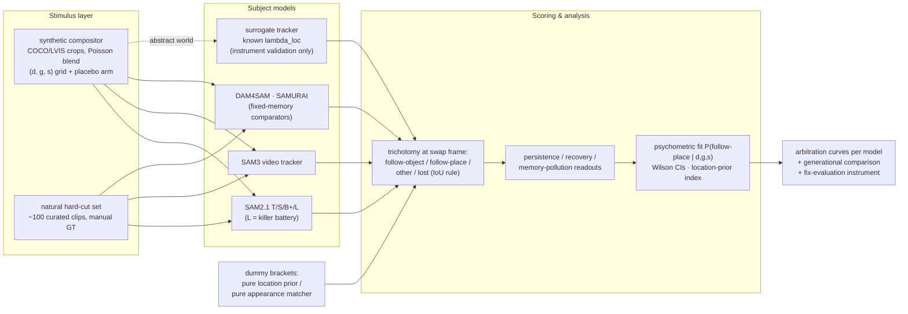

# A-0028 — Experimental Design (Sections 15–22 of 28)

Labeling per `proposal.md` Section 10: KNOWN / HYPOTHESIS / MEASURED (synthetic surrogate). All
real-model numbers in this file are RESULT SLOTS — empty until the batteries run. All synthetic
numbers are from the committed prototype run (`src/results_synthetic/report.md`, config
`src/configs/default.yaml`, seed 20260828).

---

## Section 15 — Method overview: the teleport probe

Behavioral probe; **no training anywhere in the project**. Four modules (all four exist and run today
in the synthetic mirror under `src/`; the real-model arm swaps module 2's subject):

1. **Stimulus generator** — composite clips with two objects (target + distractor at parametric
   appearance similarity) moving smoothly, then a controlled discontinuity on one frame:
   `swap` (positions exchanged — the canonical teleport), `jump` (target jumps; a background phantom
   occupies the old location), `appearance_flip` (appearance discontinuity, no motion), `placebo`
   (paste-artifact-only, nothing moves). A temporal gap g of unobserved/withheld frames precedes the
   manipulation so memory is stale at the decision point.
2. **Subject models** — SAM2.1 (T/S/B+/L), SAM3, DAM4SAM, SAMURAI (Section 17), plus the synthetic
   surrogate with known arbitration λ_loc (instrument validation only).
3. **Scoring** — prompt on frame 0 (positive point on target); at the manipulation frame, compare the
   predicted mask against object-at-new-location vs occupant-of-old-location → per-trial trichotomy
   follow-object / follow-place / other / lost; post-manipulation persistence and recovery readouts.
4. **Analysis** — per-cell rates with Wilson CIs; psychometric fit of P(follow-place | d, g, s);
   scalar location-prior index per model; memory-pollution readouts (Section 19).

### Architecture (also standalone in `diagrams/architecture.mmd`)

Single-trial flow is in `diagrams/probe_pipeline.mmd`.

## Section 16 — Stimulus design

**Synthetic battery (primary instrument).** Built from real image content: target and distractor
objects are segmented crops (COCO/LVIS instances; DAVIS/SA-V frames as donors), composited onto
video backgrounds with Poisson blending (Pérez et al. 2003) and light per-frame jitter so the clip is
a plausible video, not a slideshow. Grid axes, pre-registered:

- **Displacement d** — distance of the location discontinuity at the swap frame, in fractions of
  image diagonal: {0.05, 0.10, 0.20, 0.40, 0.60} (the synthetic-surrogate analog used px
  {4, 8, 16, 32, 64} on a 256-arena; the real battery pre-registers diagonal fractions so d is
  resolution-independent).
- **Temporal gap g** — frames withheld between the last clean observation and the swap frame:
  {1, 2, 4, 8, 16}. Implemented by frame-drop (the model simply receives the swap frame g steps after
  the last one it processed), not by frozen frames — freezing would feed the memory bank g copies of
  a stale world.
- **Distractor similarity s** — three tiers: same-instance copy / same-class different-instance /
  different-class size-matched. (The surrogate uses cosine tiers {0.2, 0.5, 0.8, 0.95}; the real
  tiers are categorical because instance-level appearance similarity is not a directly settable
  scalar for real crops. A CLIP-embedding similarity score is logged per trial as a continuous
  covariate for the psychometric fit.)
- **Conditions** — `swap` (primary), `jump` (secondary — dissociates "follows the place" from
  "follows the distractor"), `appearance_flip` and `placebo` (controls).

**Placebo-paste arm (NON-OPTIONAL, binding).** Identical compositing pipeline, identical paste
artifacts, **nothing moves**: both objects are re-pasted in place with the same blending seams,
lighting mismatch, and boundary halos a swap trial would carry. If subject models are disrupted here,
the probe measures compositing artifacts, not arbitration — pre-registered validity gate in
Section 20. MEASURED (synthetic surrogate): the prototype's placebo disruption rate is 0.000,
demonstrating the readout *can* come back clean; the real-model placebo number is a RESULT SLOT.

**Natural hard-cut arm (NON-OPTIONAL, binding).** ~100 clips curated from public, permissively
licensed edited footage (shot cuts where an object genuinely relocates across the cut: sports
broadcast angle changes, multi-camera scenes, music-video cuts), manually annotated with target
identity on both sides of the cut plus the old-location occupant. Effective (d, g, s) covariates are
measured post-hoc per clip and binned to match the synthetic grid. Purpose: external validity (H5)
against the off-manifold objection — dozens of clips per bin suffice for rank agreement (Stage-6 ENG
finding); this is a validation arm, not a benchmark.

**DiDi anchoring.** Where DiDi sequences contain distractor-swap-like events, the same scoring is
applied as a second external anchor (no curation cost; identity annotations exist).

## Section 17 — Subject models and comparators

| Subject | Checkpoint / config | Role | Battery |
|---|---|---|---|
| SAM2.1-L | `sam2.1_hiera_large` | **Killer battery** (Section 20) | full grid, week one |
| SAM2.1-T/S/B+ | official checkpoints | size scaling of the arbitration | full grid, week 2–3 |
| SAM3 | official release, visual-prompt (PVS) video mode | generational comparison (RQ2) | full grid |
| DAM4SAM (SAM2.1++) | [official repo](https://github.com/jovanavidenovic/DAM4SAM) | fixed-memory comparator: does the fix shift the curve toward appearance? (H4) | full grid |
| SAMURAI | [official repo](https://github.com/yangchris11/samurai) | fixed-memory comparator: motion-prior philosophy (H4) | full grid |
| Surrogate tracker | `src/src/a0028/tracker.py`, λ_loc known | instrument validation ONLY (E2) | CPU, done |

Protocol identical for every subject: positive point prompt on frame 0 at the target center; no
re-prompting; propagate; score. SAM3 is run in its SAM2-compatible visual-prompt video mode (KNOWN:
SAM3 retains point-prompted video segmentation). The SAM3 Tracking Zoo
([repo](https://github.com/HamadYA/SAM3_Tracking_Zoo)) is the preferred harness for the comparator
re-implementations if its licensing permits, else the official repos are used directly.

## Section 18 — Baselines and dummy brackets

Two dummies bracket the behavior space so every model curve is interpretable on an absolute scale:

- **Pure location prior** — always predicts the old location's occupant. MEASURED (synthetic
  surrogate): mean P(follow-place) 0.892 on the swap grid (not 1.0 because at small d the "old
  location" region overlaps the target's new position — the bracket also calibrates the scoring
  geometry).
- **Pure appearance matcher** — frame-0 template matching, memory never updated. MEASURED (synthetic
  surrogate): mean P(follow-place) 0.030.

Real-battery versions: (i) a template-matching dummy (frame-0 crop, normalized cross-correlation or
frozen-DINO feature matching) and (ii) a static-location dummy, both run on the identical rendered
clips and scored by the identical trichotomy. RESULT SLOT for both.

## Section 19 — Metrics, scoring, and statistical analysis plan

**Per-trial trichotomy at the manipulation frame (pre-registered IoU rule).** Let M be the predicted
mask, A the GT mask of the target at its new location, B the GT mask of the old-location occupant
(distractor in `swap`, phantom/background object in `jump`):

- follow-object: IoU(M, A) ≥ 0.5 and IoU(M, B) < 0.1
- follow-place: IoU(M, B) ≥ 0.5 and IoU(M, A) < 0.1
- lost: |M| < 0.1% of frame area (near-empty mask)
- other: everything else (split masks, third objects)

Threshold sensitivity is pre-registered as a mandatory robustness appendix: re-score the full battery
at primary-IoU ∈ {0.3, 0.5, 0.7}; the headline claims must be threshold-stable or they are not made.

**Persistence readouts (H3), over the post-manipulation window (8 frames):**
P(wrong persists to final frame | wrong at swap), P(recover | wrong at swap). Real-model
memory-pollution mechanism test: re-run wrong trials with the memory bank frozen at the pre-swap
state (SAM2's inference state permits this without retraining) — the synthetic analog (MEASURED,
surrogate, contested cell d=16/g=4/s=0.5): with memory updating, wrong picks persist at 1.000 and the
memory template rebinds to the distractor (affinity gap +0.578); frozen, rebinding never occurs
(−0.431) and recovery reappears (0.188–0.778 depending on λ). RESULT SLOT for SAM2.

**Psychometric fit.** Logistic GLM: logit P(follow-place) ~ log d + log g + s-tier (+ logged CLIP
similarity as continuous covariate) with d×s interaction, fit per model; Wichmann–Hill-style goodness
of fit; 95% CIs by bootstrap clustered on source image (paste trials sharing a donor crop are not
independent). Monotonicity tested by Spearman ρ on the marginal curves.

**Location-prior index (scalar per model).** Mean P(follow-place) over the pre-registered swap grid —
comparable across models only on the identical grid; reported with clustered-bootstrap CI. MEASURED
(synthetic surrogate) instrument validation: sweeping the surrogate's true λ_loc ∈ {0.1…0.9}, the
index recovers it monotonically (0.209 → 0.641 → 0.780 → 0.907 → 0.940; **Spearman ρ = 1.000**). This
is the core instrument-validity evidence: the probe measures the arbitration it claims to measure, on
a system where the arbitration is a known ground truth.

**Per-cell uncertainty.** Wilson score intervals (Wilson 1927) at n = 130–150 trials/cell → CI
half-width ≈ ±0.06–0.08 at p = 0.5, tighter near the extremes; adequate for curve-shape claims (the
pre-registered effect floor in Section 20 is 0.15).

## Section 20 — THE KILLER EXPERIMENT: 1-GPU-day SAM2-L battery (pre-registered)

**Binding schedule (Stage-6, load-bearing): runs in week one, day 4. No exceptions.**

- **Subject:** SAM2.1-L, official checkpoint, default inference settings, frame-0 point prompt.
- **Stimuli:** full synthetic grid — 5 displacements × 5 gaps × 3 similarity tiers = 75 cells ×
  ~130 clips ≈ **10⁴ short clips** (15 frames each: 6 prefix + swap + 8 post), plus the placebo arm
  (300 clips) and jump condition subset (25 cells × 60). Spec: `configs/killer_sam2l.yaml`.
- **Budget arithmetic (KNOWN):** ~1.6×10⁵ frames total; SAM2-L at 10–20 fps on one 24 GB GPU
  (A10G/3090/4090 class) → 2.5–4.5 h inference; with clip I/O, scoring, and the two dummy baselines:
  **≤ 1 GPU-day**. Storage ~20 GB of JPEG clips (kept for all subsequent subjects — every model sees
  byte-identical stimuli).
- **Order of operations:** placebo arm FIRST (validity gate below), then the swap grid, then jump.

**Pre-registered decision rules (evaluated day 5):**

| Gate | Rule | Verdict |
|---|---|---|
| **V (validity)** | placebo disruption rate: Wilson 95% upper bound < 0.05 | FAIL → probe invalid; fix compositing and re-run placebo; if unfixable, KILL (the probe measures paste artifacts) |
| **A (location-prior law, H1)** | Spearman ρ ≥ 0.8 on BOTH d- and g-marginals AND (max − min) marginal P(follow-place) ≥ 0.15 with non-overlapping 95% CIs | fires → arbitration-law branch; CONTINUE to full study |
| **B (appearance dominance)** | P(follow-object) ≥ 0.90 in every swap cell (CI lower bound ≥ 0.85) | fires → corrective branch; CONTINUE to full study |
| **C (unsystematic)** | neither A nor B | STOP multi-model extension; ship the instability itself as a short note (Section 26) |
| **Partial** | monotone in d but flat in g (the surrogate's own MEASURED pattern) or vice versa | counts as A with the flat axis reported as a finding — the axes are pre-registered separately |

RESULT SLOT (killer battery, to be filled day 5 of week one):

| Readout | Value | CI |
|---|---|---|
| Placebo disruption rate | — | — |
| P(follow-place) d-marginal (5 values) | — | — |
| P(follow-place) g-marginal (5 values) | — | — |
| P(follow-place) s-marginal (3 tiers) | — | — |
| Location-prior index (SAM2.1-L) | — | — |
| Gate verdict (V/A/B/C) | — | — |

**HYPOTHESIS (what we expect, from exp_07):** gate A fires with s-modulation (H2). The synthetic
surrogate's gap axis was ~flat (0.726 → 0.690 over g = 1→16, MEASURED) because appearance staleness
and motion diffusion nearly cancel in that world — the prototype pointedly does NOT prefabricate the
gap effect; whether real SAM2 shows it is exactly what the instrument exists to find out.

## Section 21 — Full experiment battery and compute budget

| Exp | Question | Subjects | Cost | Depends on |
|---|---|---|---|---|
| **E1** killer battery | RQ1: SAM2-L arbitration curves | SAM2.1-L + 2 dummies | **1 GPU-day** | stimulus gen (days 1–3) |
| **E2** instrument validation | probe recovers known arbitration | surrogate (λ sweep) | CPU, **done** (MEASURED: ρ = 1.000) | — |
| **E3** size scaling | does arbitration shift with model size? | SAM2.1-T/S/B+ | 0.5–1 GPU-day | E1 gate A or B |
| **E4** placebo + flip controls | validity (gate V) + location-anchoring control | every subject | inside each battery | — |
| **E5** generational | RQ2: SAM3 vs SAM2 on identical grid | SAM3 | ~1 GPU-day | E1 gate A or B |
| **E6** fix evaluation | RQ3/H4: do DAM4SAM & SAMURAI move the curve as their mechanisms predict? | DAM4SAM, SAMURAI | ~1 GPU-day | E1 gate A or B |
| **E7** natural cuts + DiDi anchor | RQ5/H5: external validity | SAM2.1-L (+SAM3 if budget) | ~0.5 GPU-day + curation | curation (starts day 5, parallel) |
| **E8** memory-pollution mechanism | RQ4/H3: frozen-memory ablation on wrong trials | SAM2.1-L | ~0.5 GPU-day | E1 |

**Total: 1 GPU-day core (E1); 3–5 GPU-days full study; single 24 GB GPU; no training.** Engineering:
~1 week stimulus curation (days 1–3 generator + smoke batch; natural-cut curation in parallel from
day 5, bounded at dozens-per-bin). E2–E4 synthetic analogs are already MEASURED in the committed
prototype run — E1's RESULT SLOT is the only blocker for the E3/E5/E6 fan-out.

RESULT SLOT (per E3/E5/E6/E7/E8 — one arbitration-curve figure + location-prior index each; the
generational and fix-evaluation deltas are the paper's Figures 4–5).

## Section 22 — Datasets, provenance, and curation protocol

- **Donor objects:** COCO 2017 val instances ([COCO](https://cocodataset.org), arXiv:1405.0312) and
  LVIS v1 rare categories (arXiv:1908.03195) — segmented crops; instance masks are the paste masks.
- **Backgrounds:** DAVIS 2017 (arXiv:1704.00675) and SA-V (SAM2 release) frames — real video
  backgrounds with natural camera motion; MOSE (arXiv:2302.01872) scenes for crowded backgrounds.
- **External anchors:** DiDi (DAM4SAM repo) — distractor-distilled sequences, identity annotations
  reused; natural hard-cut set — curated per Section 16, released with annotations under the source
  clips' licenses (CC-licensed sources only).
- **Provenance discipline:** every trial stores donor-image IDs, paste coordinates, blend seed, and
  grid cell in the results JSON (the prototype already does this per-cell with crc32-derived seeds);
  every battery is re-runnable byte-identically from its config + seed.
- **No training data anywhere** — the probe never fine-tunes; contamination concerns are limited to
  the trivial one (subject models may have seen COCO/DAVIS images in training — acceptable and
  disclosed: the probe measures tracking arbitration on familiar *content*, which is the deployment
  condition, and the swap event itself is never in any training set).
