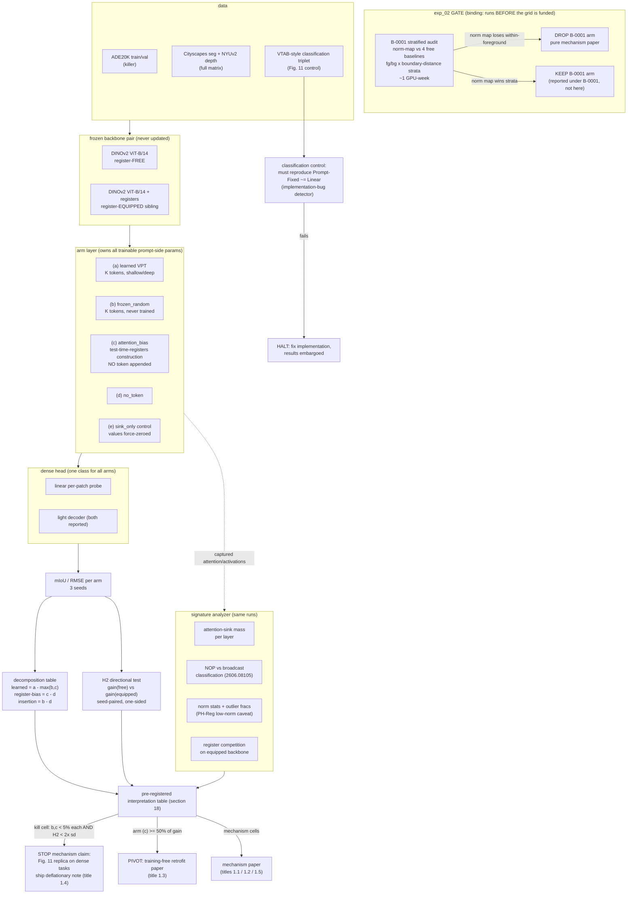

# Proposal — B-0114: Prompts as Registers (4-arm dense-task mechanism)

Sections §1–§9 of the 28-section Stage-7 package. Seat: Final-3 #3, PI rank Idea_03.

---

## §1 Candidate titles

Title seeds carried from Stage-6 (`stage6_agent_S/final3.md`), plus two package-stage additions.
The final title is chosen by outcome branch (§18–§19 of `experiments.md`):

1. **"Prompts as Registers: Dissociating Register Function from Learned Content in Visual Prompt Tuning"**
   — default; fits the mechanism-confirmed and mixed branches.
2. **"What Do Prompt Tokens Actually Do on Dense Tasks? A Four-Arm, Two-Backbone Dissociation"**
   — question-form; fits every branch including the deflationary one; safest with hostile reviewers.
3. **"Free Registers: Attention-Bias Injection as a Training-Free Substitute for VPT on Dense Prediction"**
   — ONLY if the arm-(c) ≥ 50% pivot fires (§19); the constructive/retrofit branch.
4. *(package addition, deflationary branch)* **"Learned Content Is Still the Whole Story: Extending VPT's
   Prompt-Fixed Ablation to Dense Prediction and Register-Equipped Backbones"** — the honest-death title;
   pre-drafting it is part of the pre-registration (a negative result with a name is harder to bury).
5. *(package addition, H2-led branch)* **"Registers Built In: Why Visual Prompt Tuning Gains Less on
   Register-Equipped Backbones"** — if H2 is the strongest effect and the arm decomposition is mixed.

## §2 Battle-locked claim & seat definition

**Claim (binding, from `stage6_agent_S/final3.md`):** VPT's dense-task gains are partly register
function — token arms dissociate register absorption from added capacity, and the norm-map arm tests
artifact maps as free uncertainty.

**Seat definition:** the registers/PEFT **mechanism** seat of the Windows2 Final 3. Seated 5–2–1 over
B-0194 and C-0338; ranked #3 behind C-0306 (8–0) and A-0028 (6–2). The arms, the 2-backbone axis, and
the **exp_02-before-grid ordering condition are binding on this package** — they are not editorial
choices and may not be weakened during execution without a new PI decision.

What this seat is NOT:
- NOT the original B-0114 "afternoon frozen-token pilot" (struck by `PI_BINDING.md`; VPT Fig. 11 is prior art).
- NOT a B-0001 uncertainty paper (this package makes **no uncertainty claims**; see §15 and §27).
- NOT a classification PEFT benchmark paper (classification appears only as a bug-detector control, §16).

## §3 Executive summary / abstract

Visual Prompt Tuning (VPT; Jia et al., ECCV 2022) is the most-used token-based PEFT method for frozen
ViTs, and its own ablation (Fig. 11) settled — for **classification** — that its gains come from learned
prompt content, not from the enlarged sequence length: Prompt-Fixed ≈ Linear. Separately, the register
literature (Darcet et al., ICLR 2024) established that ViTs trained without dedicated register tokens
develop high-norm artifact tokens that corrupt **spatial** feature maps, and that appended tokens can
absorb this global computation. DA-VPT (CVPR 2025) observed register-style artifacts in VPT prompt
attention maps and called registers "analogous to learnable prompts" — so the connection is in print,
but **nobody has quantified it, and the classification-only Fig. 11 ablation has never been run where
registers actually matter: dense prediction.**

This project runs the missing dissociation. On a real dense benchmark (ADE20K), with a frozen
register-free backbone (DINOv2) and its register-equipped sibling (DINOv2-reg), we train four arms at
matched trainable parameters: (a) full VPT, (b) frozen-random tokens, (c) attention-bias-only injection
(test-time-registers construction, no token content), and (d) a no-token dense readout. A pre-registered
decomposition attributes VPT's dense gain to learned content, token insertion, and attention-geometry
(register) function; signature diagnostics (attention-sink mass, NOP-vs-broadcast classification,
norm statistics) test whether learned prompts *become* registers; and the directional hypothesis H2 —
VPT gains more on the register-free sibling — tests the mechanism's own prediction. Every cell of the
outcome table is interpretable: register function confirmed → the mechanism story of the most-used PEFT
method is rewritten on dense tasks, and arm (c) doubles as a **training-free VPT substitute** (retrofit
recipe); register function absent → the project **stops the mechanism claim** and ships the dense-task
completion of Fig. 11 (the deflationary note has a pre-drafted title, §1.4). The killer grid costs
24 runs ≈ 1–1.5 GPU-weeks and is gated by a ~1-GPU-week audit (exp_02) that decides the B-0001 arm's
fate before the grid is funded.

## §4 Provenance & pipeline lineage

| Stage | Agent | Action on B-0114 |
|---|---|---|
| 1 | A (batch B origin) | idea B-0114 "VPT prompt tokens are trainable registers" enters the 1042 |
| 2 | E | bet #1 of batch B; sold on the (later-struck) "afternoon frozen-token pilot" |
| 2–3 | G, M | G LOCK (mission-protected); survives the 190→50 cut |
| 4 | H (Reviewer-2) | **REJECTION of the naive form; SURVIVE-IF-EXPERIMENT in the 4-arm redesign** — DA-VPT already prints the connection; frozen-token control confounded (softmax denominator); mush risk named; 4-arm + 2-backbone + dense tasks is H's construction (`stage4_agent_H/reviewer2_attacks.md` §W2-B-0114) |
| 5 | N | exp_01 protocol (killer grid, metrics, kill criteria) + exp_02 (B-0001 audit + dissociation plan) |
| 6 | L (audit) | **Finding 1:** the "afternoon pilot" was already run by VPT Fig. 11 in 2022 (classification); flags NOP/broadcast diagnostics (arXiv:2606.08105) as mandatory readout axes |
| 6 | PI | **PI_BINDING.md:** keep ONLY the 4-arm dense-task redesign or drop; B-0114 × B-0001 = one bet unless dissociated |
| 6 | Q | Top-5 seat 2; exp_02-before-grid ordering condition made binding (Round 3) |
| 6 | S | Final-3 seat 3 (5–2–1); ranked #3 (A-0028 #2 at 6–2); kill/pivot criteria locked |
| 7 | T | synthetic prototype (`src/prototype/`, verbatim copy) — instrument validated on CPU sandbox; sandbox outcome was content-dominant (see §20 for the honest read) |
| 7 | **W (this package)** | full 28-section package draft |

The lineage's central correction is L's Finding 1: five agents repeated the "afternoon pilot" framing
without re-reading VPT's ablation section. This package therefore treats **"reproduce Fig. 11 on the
classification control"** as its built-in implementation-bug detector (§16) and **"replicate Fig. 11 on
dense tasks"** as a pre-registered stopping outcome, not an embarrassment to be argued around (§19).

## §5 Research question

On **dense prediction tasks**, is part of VPT's gain over a plain dense readout produced by **register
function** — prompt tokens absorbing global aggregation / acting as attention biases, keeping patch
tokens spatially clean — rather than by the **learned task content** of the prompt embeddings? And does
the mechanism predict its own boundary condition: do VPT gains shrink on backbones that already have
registers?

Three sub-questions, each owned by one axis of the design:

- **RQ1 (attribution):** what fraction of the dense-task VPT gain survives when token *content* is
  removed (frozen-random arm) or when only attention *geometry* is injected (bias-only arm)?
- **RQ2 (signatures):** do learned VPT prompts develop register signatures — attention-sink mass,
  high-norm statistics, NOP-vs-broadcast behavior — that frozen prompts do not?
- **RQ3 (boundary/H2):** is the gain systematically smaller on the register-equipped sibling backbone,
  as the register-function account predicts and the pure-content account does not?

## §6 Falsifiable hypotheses & pre-registered predictions

**H1.** On register-free ViT backbones and dense tasks, the attention-bias-only arm (c) reproduces a
statistically non-zero fraction of VPT's gain over the no-token baseline, and VPT-trained tokens develop
register signatures (classified by the NOP-vs-broadcast diagnostics of arXiv:2606.08105) that
frozen-random tokens do not.

**H2 (directional, pre-registered).** gain(VPT | register-free backbone) > gain(VPT | register-equipped
sibling) on dense tasks, at matched trainable parameters. Test: one-sided comparison of seed-paired gain
differences; declared only if the gap exceeds 2× pooled seed sd (§17).

**Falsified if:** on register-free backbones, arms (b) and (c) each reproduce <5% of VPT's dense gain
across seeds (all gain is learned content — the dense-task analogue of VPT Fig. 11), **AND** the H2 gap
is within 2× seed sd. This joint condition is the pre-registered kill cell (§19).

**Predictions (HYPOTHESIS, not measured — including on our own sandbox, see §20):**
dense tasks behave differently from the classification setting where Prompt-Fixed ≈ Linear (KNOWN,
VPT Fig. 11), because register artifacts corrupt *spatial* feature maps (KNOWN, Darcet et al.); we
predict a minority-but-nonzero register component on ADE20K and a positive H2 gap outside seed noise.
Prior probability is deliberately not inflated: Agent T's sandbox — constructed to *favor* the
mechanism — came back content-dominant, so the deflationary branch carries substantial mass and its
outputs are pre-committed (§19, §27).

**Directional prediction that silences Reviewer-2 if confirmed (H's construction):** H2 is the
mechanism's own falsifiable forecast. A content-only account gives no reason for VPT gains to depend on
whether the backbone shipped with registers; the register-function account requires it.

## §7 Contributions (conditional on outcomes)

Claimed only per branch; the interpretation table (§18) maps outcomes to claims.

1. **The dense-task completion of VPT's Fig. 11 ablation** — delivered in *every* branch. The
   classification-only ablation has anchored "prompts = learned content" since 2022; no one has run it
   where register artifacts matter.
2. **A quantified decomposition** of dense VPT gains into learned content / insertion / attention-geometry
   components with a telescoping identity (learned = a−max(b,c); register-bias = c−d; insertion = b−d).
3. **The first register-signature characterization of learned prompts** (sink mass, NOP/broadcast class
   shares, norm statistics on the *same* runs as the performance decomposition).
4. **The H2 boundary law** — whether VPT's usefulness is partly a register-free-backbone artifact; directly
   actionable for practitioners choosing PEFT methods on DINOv2-reg-class backbones.
5. **(Pivot branch only)** a training-free VPT substitute for dense tasks: attention-bias injection as a
   retrofit recipe — the portfolio's second constructive shot.
6. **(Gate branch, exp_02)** the stratified verdict on register-norm maps as free uncertainty — reported
   under B-0001's name, never this paper's (§15, §27).

## §8 Method — arms, decomposition, backbone pair

### The four arms (binding) + one control arm

All arms share one frozen backbone per (variant, seed) and one dense-head class; only prompt-side
parameters and the head are trainable. Matched trainable parameters across arms wherever tokens exist.

| Arm | Name | Tokens | Trained | Isolates |
|---|---|---|---|---|
| (a) | `learned` (full VPT) | K learned tokens (VPT-shallow; VPT-deep in the full matrix) | tokens + head | the full effect |
| (b) | `frozen_random` | K random tokens, never updated | head only | token insertion (geometry + denominator), no content |
| (c) | `attention_bias` | **no token** — per-layer additive attention-logit bias, test-time-registers construction (arXiv:2506.08010) | bias params + head | register/sink function without sequence-length change |
| (d) | `no_token` | none | head only | dense readout baseline |
| (e) | `sink_only` (control, from H) | K tokens, **values force-zeroed**; keys trainable | keys + head | attention-geometry with a token present but content-mute |

Arm (c) is the load-bearing arm: it is what converts DA-VPT's "analogous to learnable prompts" from
cosmetic analogy into a mechanism identification, because it can bend attention geometry but cannot
inject content. Arm (e) bounds the gap between (b) and (c): it shares (b)'s softmax-denominator change
and (c)'s content-muteness (see §21 for the residual confound accounting).

### The decomposition (pre-registered identities)

Per backbone, per seed, in task metric units (mIoU):

- total VPT gain = a − d
- insertion = b − d
- register/bias = c − d
- learned content = a − max(b, c)
- (prototype's finer split, retained as a secondary readout: content-transfer = a′ − b where a′ re-uses
  arm-(a) tokens frozen under a fresh head; telescoping asserted seed-wise in code — see `src/prototype/`)

### The backbone pair (binding)

- **Register-free:** DINOv2 ViT-B/14 (arXiv:2304.07193) — the canonical high-norm-artifact backbone.
- **Register-equipped sibling:** DINOv2 ViT-B/14 **with registers** (Darcet et al., arXiv:2309.16588;
  checkpoints released in the DINOv2 repo) — same data, same recipe, registers added.
- Full matrix adds one supervised ViT-B pair via PH-Reg/test-time-register patching (§16) to show the
  contrast is not a DINOv2 quirk.

### Signature diagnostics (mandatory per L Finding 1)

On the same runs: (i) attention-sink mass of patch queries onto prompt slots per layer; (ii) prompt and
patch norm distributions incl. outlier fractions (with the PH-Reg caveat that low-norm artifacts exist —
norms alone never define register function); (iii) **NOP-vs-broadcast classification** of prompt tokens
per the attention-sink diagnostics of arXiv:2606.08105; (iv) register-competition readout on the
equipped backbone (do prompts displace attention mass from built-in registers?).

## §9 Architecture & system design

Real-experiment system (source of truth: `diagrams/architecture.mmd`; gate flow in
`diagrams/decision_gates.mmd`; the prototype's own diagram is in `src/prototype/ARCHITECTURE.md`).

Design invariants carried from the prototype (enforced there by tests, to be re-enforced at scale):
(1) the backbone is arm-independent and bit-identical across arms; (2) one head class for every arm,
reading patch tokens only — prompt/register slots are never visible to the readout; (3) the
decomposition telescopes by construction; (4) EXPECTED (pre-registered) and MEASURED are printed in
separate blocks by the runner; (5) B-0001 quarantine — no import path from mechanism modules to the
norm-vs-error hook, which runs only under an explicit flag (§15, §27).
