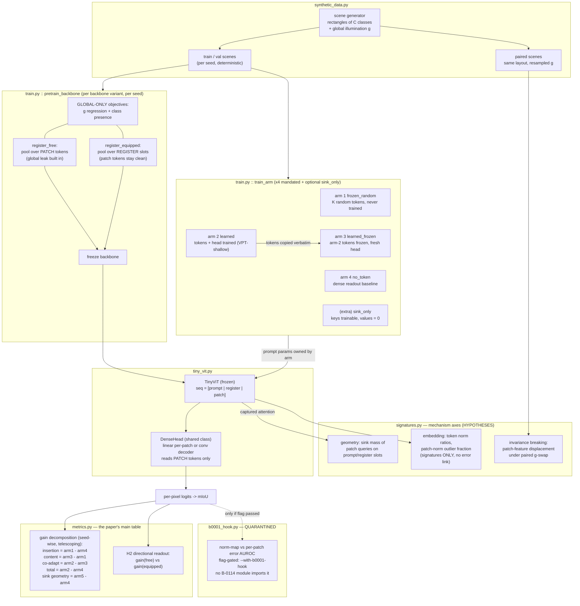

# Architecture — B-0114 4-arm dense-task prototype

## Dataflow

## Module map

| module | role | key invariants (tested) |
|---|---|---|
| `synthetic_data.py` | scenes + global nuisance g; paired-g renders | deterministic per (seed, split); paired renders share layout; g moves pixels |
| `tiny_vit.py` | ViT-tiny, slot layout `[prompt\|register\|patch]`, sink mode, dense heads | value-zeroing matches reference impl; linear head strictly per-patch; forward never mutates backbone params |
| `train.py` | global-only pretraining; per-arm training | backbone frozen & bit-identical across arms; `frozen_random` tokens equal their init; `learned_frozen` reuses arm-2 tokens verbatim |
| `metrics.py` | mIoU, decomposition, H2 | decomposition telescopes exactly seed-wise; H2 needs both backbones |
| `signatures.py` | sink mass, norm signatures, nuisance sensitivity | sink mass 0 without tokens, bounded by 1; sensitivity 0 on identical renders |
| `b0001_hook.py` | quarantined B-0001 seam | AUROC correct on known cases; import isolation + flag gating enforced by AST tests |
| `config.py` | YAML + validation | `learned_frozen` requires `learned`; geometry synced data↔model |
| `run_synthetic.py` | orchestration, EXPECTED vs MEASURED report | arm order guarantees `learned` before `learned_frozen`; JSON dump reproducible |

## Design invariants

1. **The backbone is arm-independent.** Prompt parameters are owned by the
   arm; `train_arm` never touches backbone weights (asserted per state-dict
   key in tests). The decomposition is meaningless without this.
2. **One head class for every arm** (linear or conv, per config) so head
   capacity cannot masquerade as a token effect; the head reads patch
   tokens only — prompt/register slots are never visible to the readout.
3. **The decomposition telescopes by construction**:
   insertion + content_transfer + co_adaptation = total VPT gain, seed-wise.
4. **Hypotheses stay hypotheses.** The runner prints EXPECTED (pre-registered
   from exp_01) and MEASURED (synthetic) in separate blocks; H2 confirmation
   lines are tagged as sandbox mechanism checks.
5. **B-0001 quarantine** (PI binding): no import path from B-0114 modules to
   `b0001_hook.py`; hook output only under an explicit flag and banner.
