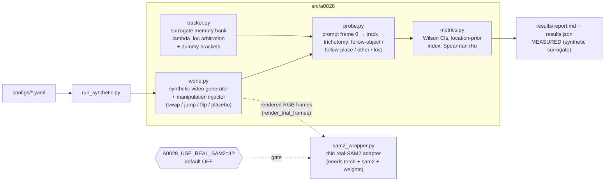

# A-0028 teleport-probe prototype (Stage 7, Agent R)

**Idea:** W2-A-0028 — *the SAM2 teleport test: appearance vs location tracking*.
**Protocol source:** `Windows2/_wip/stage5_agent_N/exp_07.md` (killer-experiment spec),
revived in `Windows2/_wip/stage6_agent_L/revive.md` (#3), seated at
`Windows2/_wip/stage6_agent_O/top20.md` (#6).

This is a **runnable minimal prototype** of the probe — CPU only, **no GPU, no
SAM2 weights, no network**. It builds the measurement instrument and validates
it on a surrogate memory tracker whose appearance-vs-location arbitration is a
known ground truth. It does **not** measure SAM2.

## Labeling rule (read this first)

- **MEASURED (synthetic surrogate)** — every number in `results/` and in this
  README's results section. Produced by `run_synthetic.py` on the surrogate
  tracker defined in `src/a0028/tracker.py`.
- **EXPECTED (hypothesis)** — anything about SAM2/SAM3/DAM4SAM behavior. No
  SAM2 number appears anywhere in this prototype, and none is implied. The
  exp_07 predictions (e.g. "P(follow-place) rises monotonically with
  displacement and temporal gap for SAM2") remain unmeasured hypotheses until
  the real-model arm is run.

## What the prototype does

1. **Simulates a tracker memory / masklet state.** `MemoryBankTracker` keeps a
   recency-decayed bank of (appearance embedding, location) observations of
   the tracked masklet — the functional shape of SAM2-style memory attention —
   and scores frame candidates by
   `(1 − λ)·appearance_similarity + λ·location_prior`, with the arbitration
   `λ = lambda_loc` an explicit, known parameter.
2. **Injects a controlled discontinuity** on one frame (`src/a0028/world.py`):
   `swap` (identity swap / teleport-exchange), `jump` (abrupt location jump
   onto a background phantom), `appearance_flip` (appearance discontinuity,
   no motion), `placebo` (paste-artifact-only control, nothing moves).
   A temporal gap `g` of unobserved world steps precedes the manipulation, so
   memory is stale at the decision point; appearance drift lives in the
   *world*, not the tracker, so gap effects are emergent, never hard-coded.
3. **Measures wrong-identity continuation.** Per-trial trichotomy at the
   manipulation frame (follow-object / follow-place / other / lost), then
   post-manipulation persistence, recovery, and a representation-level
   readout: does the memory template rebind to the distractor's appearance
   after a wrong pick (memory pollution — the hypothesized failure)?
4. **Documents the Reviewer-2 control** (below) with a measured placebo arm.

## How to run

```bash
cd Windows2/_wip/stage7_proto_A0028
pip install -r requirements.txt        # numpy, PyYAML, pytest — CPU only
python run_synthetic.py --config configs/default.yaml --out results/   # ~30 s
python run_synthetic.py --config configs/smoke.yaml --out /tmp/smoke   # ~2 s
python -m pytest tests/ -q             # 23 tests
```

Outputs: `results/results.json` (full cells with Wilson CIs) and
`results/report.md` (rendered tables). Runs are deterministic given the config
seed (per-cell crc32-derived streams).

## Architecture



## Experiments and MEASURED synthetic behavior

From the committed `results/report.md` (`configs/default.yaml`, seed 20260828,
150 trials/cell on the 5×5×4 grid; all numbers MEASURED on the surrogate at
λ = 0.5 unless stated):

- **E1 — arbitration curves (swap).** P(follow-place) rises monotonically with
  displacement (0.168 at d=4 → 0.999 at d=64) and with distractor similarity
  (0.574 at s=0.2 → 0.856 at s=0.95). The temporal-gap axis is ~flat
  (0.726 → 0.690 over g=1→16): in this world, appearance staleness (pushes
  toward place) and motion diffusion (pushes away from place) nearly cancel.
  That flatness is a *validity* feature — the probe does not manufacture the
  hypothesized gap effect; whether real SAM2 shows it is exactly what the
  instrument is for. Dummy brackets behave as designed: pure location prior
  0.892, pure appearance matcher 0.030 mean P(follow-place).
- **E2 — instrument validation (the core claim).** Sweeping the surrogate's
  true λ ∈ {0.1…0.9}, the probe's location-prior index recovers it
  monotonically: 0.209 → 0.641 → 0.780 → 0.907 → 0.940, Spearman ρ = 1.000.
  The dissociation probe measures the arbitration it claims to measure, on a
  system where ground truth is known.
- **E3 — wrong-identity continuation (the hypothesized failure).** At a
  contested cell (d=16, g=4, s=0.5): an appearance-leaning tracker (λ=0.2) is
  wrong at the swap in 1% of trials; λ=0.5 in 97%; λ=0.8 in 99%. Given a wrong
  pick with memory update ON, the wrong identity persists to the last frame in
  100% of trials, recovery 0%, and the memory template rebinds to the
  distractor (affinity gap +0.58). With the bank FROZEN, the template never
  rebinds (−0.43) and recovery reappears (19–78% depending on λ). Memory
  pollution — the tracker/memory continuing the wrong identity — is
  demonstrated as a mechanism, and the frozen-memory ablation isolates it.
- **E4 — Reviewer-2 controls.** Paste-artifact placebo (perturb appearance,
  move nothing): disruption rate 0.000. Appearance flip (no motion): the
  tracker keeps the masklet at the unchanged location (follow-object 1.000) —
  location anchoring absorbs a pure appearance discontinuity.

EXPECTED (hypothesis, from exp_07 — **not** measured here): SAM2 shows a
monotone location-prior curve in d and g with similarity shifting it left;
SAM3/DAM4SAM curves shifted toward appearance. Either outcome is a finding.

## Reviewer-2 control (what the claim is, and is not)

The distractor-drift *phenomenon* is already documented and actively being
fixed — DAM4SAM (CVPR 2025, arXiv:2509.13864, distractor-aware memory + DiDi
dataset) and the SAM2/SAM3 memory-design study (arXiv:2512.22624). **The claim
of A-0028 is therefore NOT "SAM2 fails on jumps."** The claim is the
*dissociation probe itself*: the fix-papers presuppose an appearance-vs-
location arbitration that nobody has measured; this probe measures it as a
psychometric curve in (d, g, similarity) and doubles as an evaluation
instrument for memory designs (a fixed memory should show a measurably
shifted curve). This prototype backs that claim the only way a synthetic
prototype honestly can: by validating that the probe recovers a *known*
arbitration on a surrogate (E2), that its failure readout tracks a real
mechanism (E3), and that it is not confounded by the manipulation artifact
itself (E4 placebo — the synthetic analog of exp_07's paste-without-teleport
arm; the real-model protocol additionally requires the natural-hard-cut
validation arm exp_07 specifies).

## Optional real-SAM2 arm (gated OFF by default)

`src/a0028/sam2_wrapper.py` is a thin adapter that WOULD run the same stimuli
through real SAM2. It refuses to construct unless **all** of these hold:
`A0028_USE_REAL_SAM2=1`, `A0028_SAM2_CHECKPOINT` points at an existing
checkpoint, `A0028_SAM2_MODEL_CFG` names a model config, and `torch` + `sam2`
are installed. Nothing in the synthetic runner or tests touches it; the tests
assert it raises when disabled. `render_trial_frames` rasterizes the abstract
world to RGB frames so the adapter has a genuine input path.

## Layout

```
stage7_proto_A0028/
├── README.md                  ← this file
├── requirements.txt
├── run_synthetic.py           ← synthetic runner (E1–E4)
├── configs/
│   ├── default.yaml           ← full grid, ~30 s CPU
│   └── smoke.yaml             ← seconds, used by docs/tests
├── src/a0028/
│   ├── world.py               ← synthetic video + manipulation injector
│   ├── tracker.py             ← surrogate memory bank + dummy brackets
│   ├── probe.py               ← trial runner + trichotomy scoring
│   ├── metrics.py             ← Wilson CI, arbitration index, Spearman
│   ├── config.py              ← YAML loading
│   └── sam2_wrapper.py        ← env-gated real-SAM2 adapter (OFF)
├── tests/                     ← 23 pytest tests (world/tracker/probe/gate)
└── results/                   ← committed MEASURED example run (default.yaml)
```

## Limits (honest scope)

This surrogate is a *functional* model of a memory tracker, not SAM2: no
image encoder, no mask decoder, no learned memory attention. It exists to (a)
prove the probe pipeline end-to-end, (b) validate the instrument against a
known arbitration, and (c) demonstrate the wrong-identity-continuation
mechanism the hypothesis is about. Every real-model statement in exp_07 —
including H1's monotone gap prediction, which this surrogate's ~flat gap axis
pointedly does not prefabricate — stays EXPECTED until the gated SAM2 arm is
run on real stimuli with the paste placebo and natural-cut validation arms.
