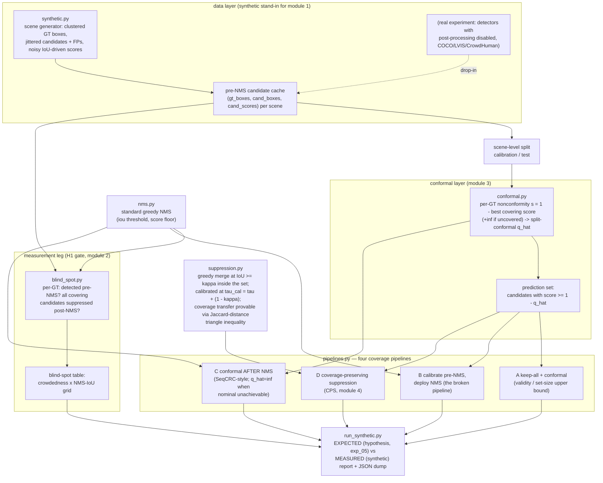

# Architecture — C-0306 prototype (conformal coverage vs NMS)

The prototype mirrors the module structure of the real killer experiment
(exp_05 §Method sketch): the synthetic generator stands in for the
candidate-cache harvester; everything downstream consumes only
`(gt_boxes, cand_boxes, cand_scores)` triples, so cached real-detector
outputs are a drop-in replacement.

## Module map

| Module | Role | exp_05 counterpart |
|---|---|---|
| `src/conformal_nms/synthetic.py` | i.i.d. clustered scenes, jittered candidates, noisy scores | module 1 (candidate-cache harvester) — synthetic stand-in |
| `src/conformal_nms/boxes.py` | vectorized IoU | shared util |
| `src/conformal_nms/nms.py` | standard greedy NMS (kept boxes suppress; no chaining) | the intervention under study |
| `src/conformal_nms/blind_spot.py` | per-GT blind-spot flags + stratified table | module 2 (blind-spot analyzer, the H1 gate) |
| `src/conformal_nms/conformal.py` | split-conformal calibration on candidate sets, +inf handling | module 3 (conformal layer) |
| `src/conformal_nms/suppression.py` | CPS with provable coverage transfer, redundancy budget | module 4 (the constructive method) |
| `src/conformal_nms/pipelines.py` | pipelines A–D + shared metrics (coverage, SE, set size, duplicates, blind-stratum coverage) | module 5 (frontier evaluator, minimal form) |
| `src/conformal_nms/config.py` | YAML -> dataclasses | — |
| `run_synthetic.py` | entry point; EXPECTED-vs-MEASURED report | — |

## Key invariants encoded in code (and tested)

1. **NMS suppression never chains** — only kept boxes suppress
   (`nms.py`, `tests/test_nms.py` vs a brute-force reference). CPS relies on
   the same property.
2. **Uncovered GT = infinite nonconformity** — post-NMS blind objects make
   nominal coverage *unachievable*, and the calibration reports it as
   `q_hat = +inf` instead of silently under-covering
   (`conformal.py`, `tests/test_conformal.py`).
3. **CPS theorem** — every GT covered at `tau_cal = tau + (1 - kappa)` by the
   pre-suppression set stays covered at `tau` after suppression,
   deterministically per scene (`suppression.py`,
   `tests/test_suppression.py::test_theorem_coverage_transfer_exact`).
