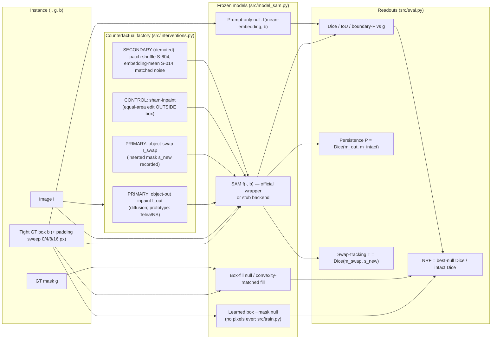
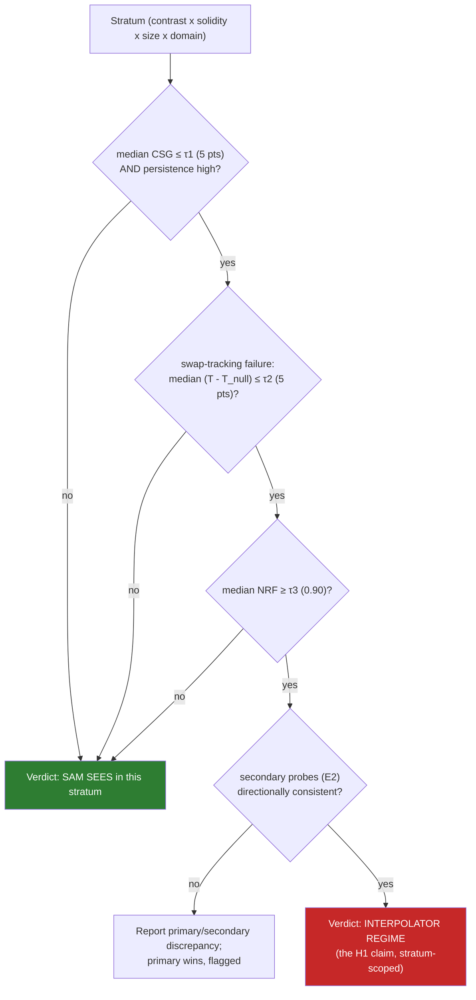
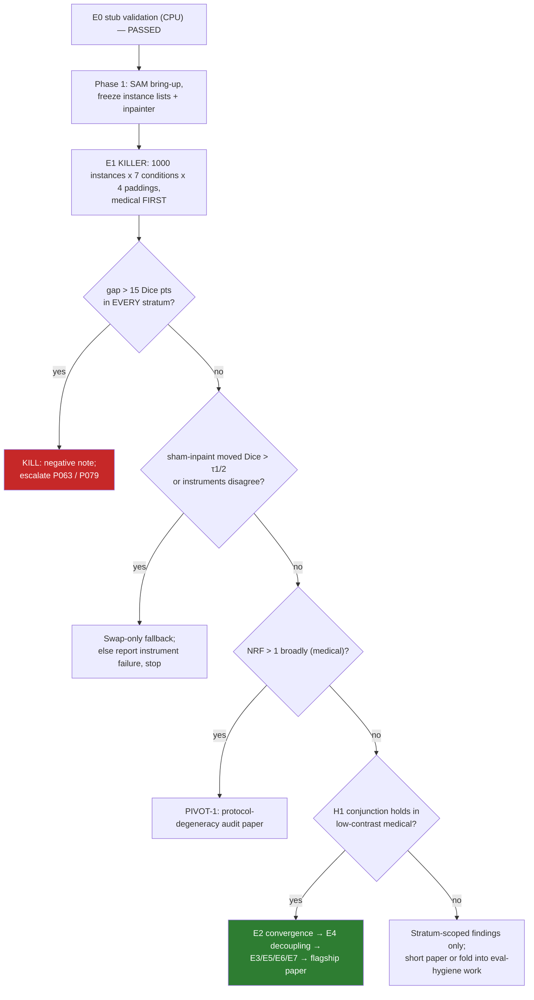
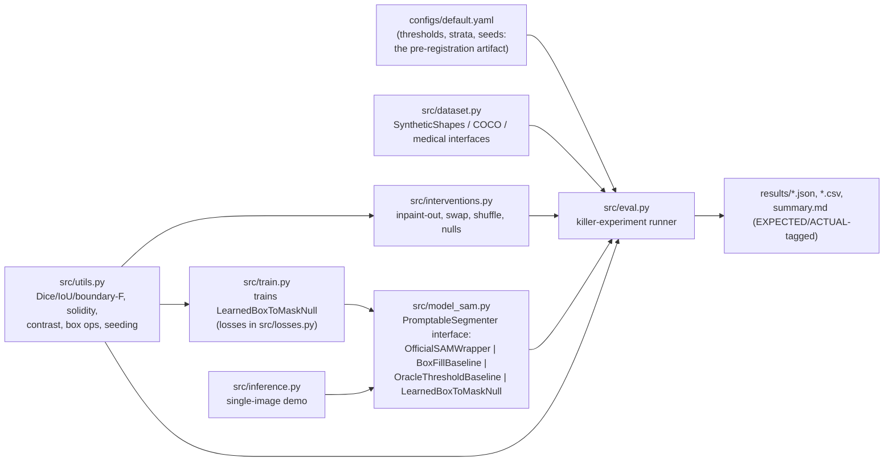

# SeeingInside — Architecture Diagrams

## 1. Measurement pipeline (per instance)

## 2. Verdict logic (pre-registered conjunction, per stratum)

## 3. Program decision tree (from roadmap.md)

## 4. Prototype code layout

