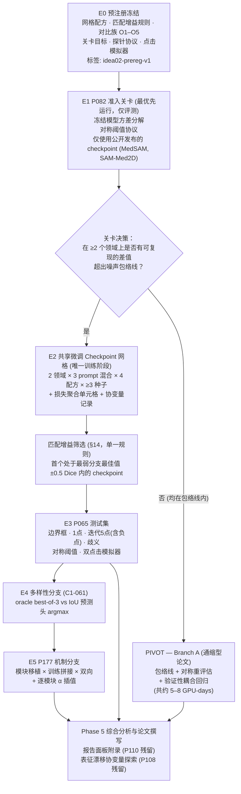
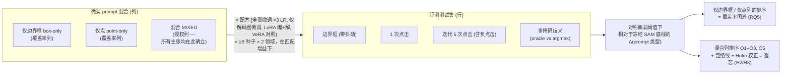
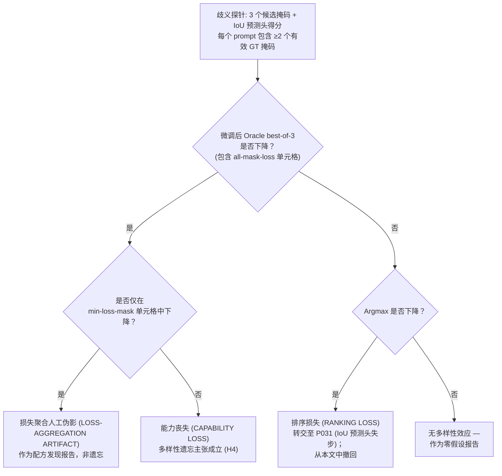
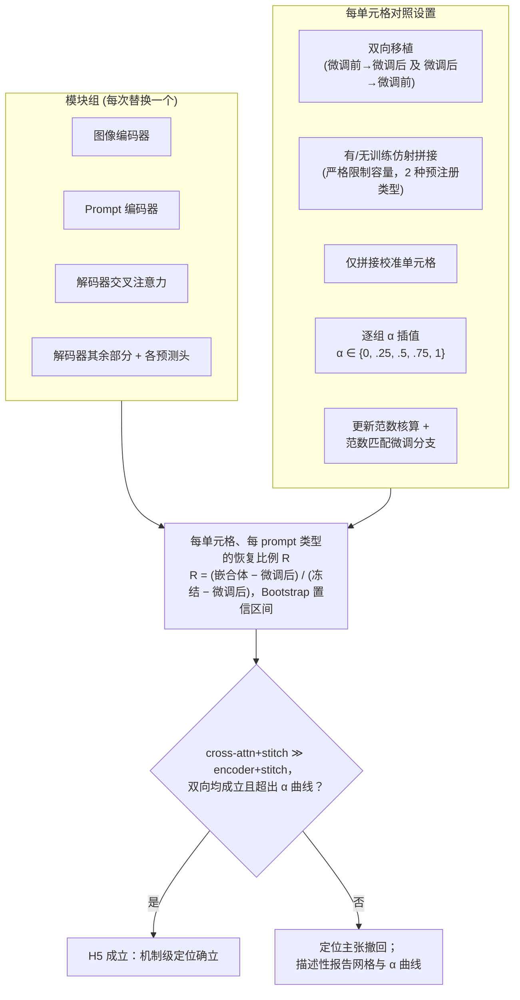
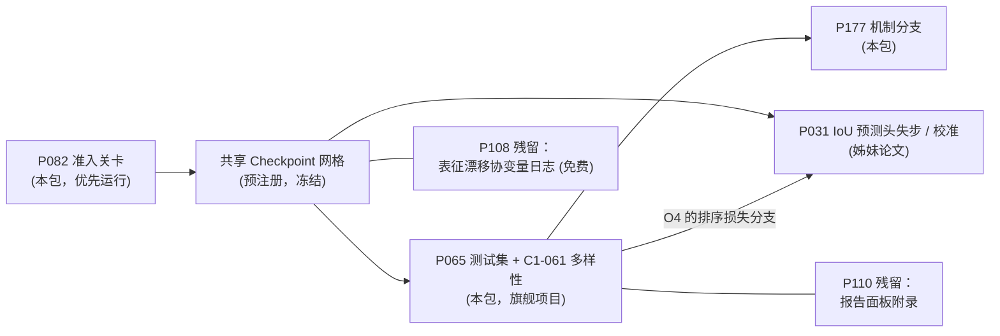

# PromptAmnesia — 架构图（Windows4 / Idea_02）

认识论状态说明：DESIGN DIAGRAMS。此处未包含任何实验结果。

## 1. 带有准入关卡决策的研究流水线

## 2. P065 析因设计 — 覆盖率与遗忘的解耦分离

## 3. 多样性分解决策树 (C1-061)

## 4. P177 移植 / 拼接网格

## 5. 项目组合接口与执行顺序

