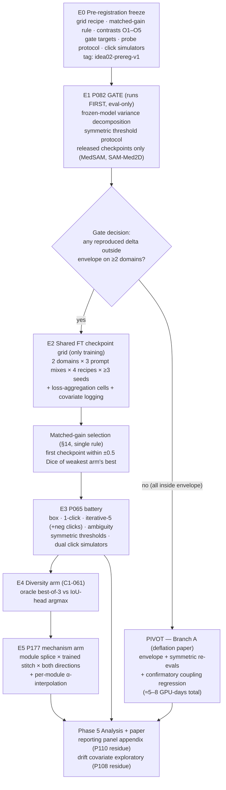
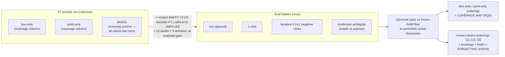
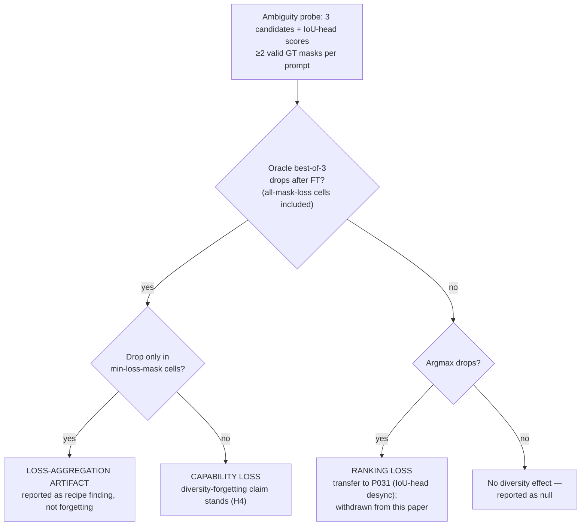
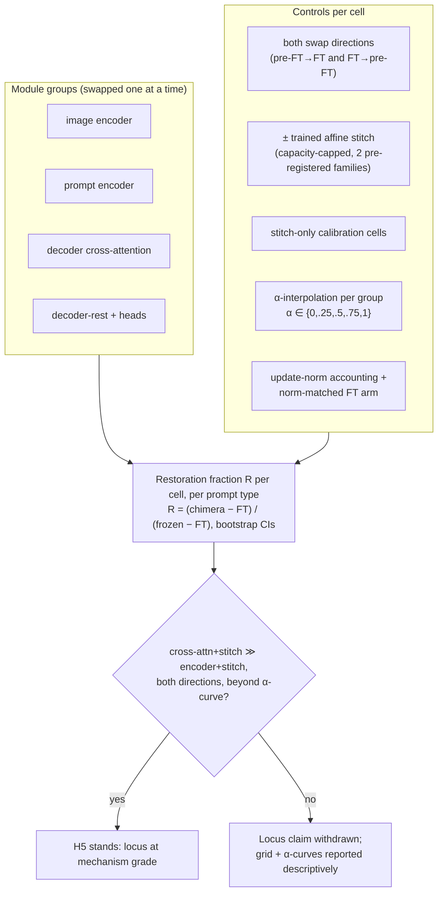
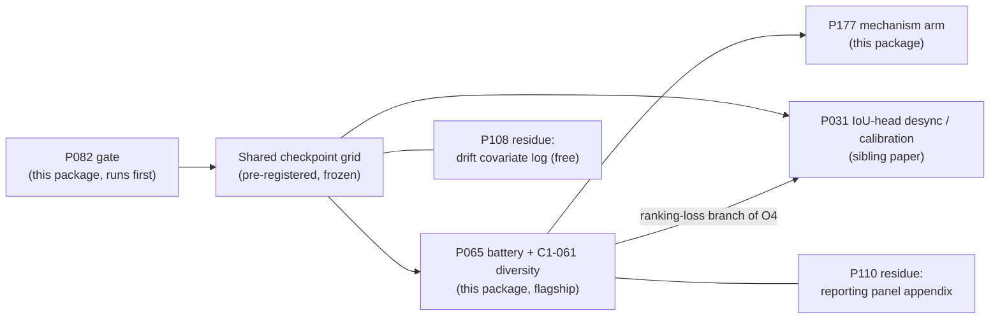

# PromptAmnesia — Diagrams (Windows4 / Idea_02)

Epistemic status: DESIGN DIAGRAMS. No results are encoded here.

## 1. Study pipeline with gate decision

## 2. P065 factorial — coverage vs forgetting separation

## 3. Diversity decomposition decision tree (C1-061)

## 4. P177 splice/stitch grid

## 5. Portfolio interfaces and execution order

