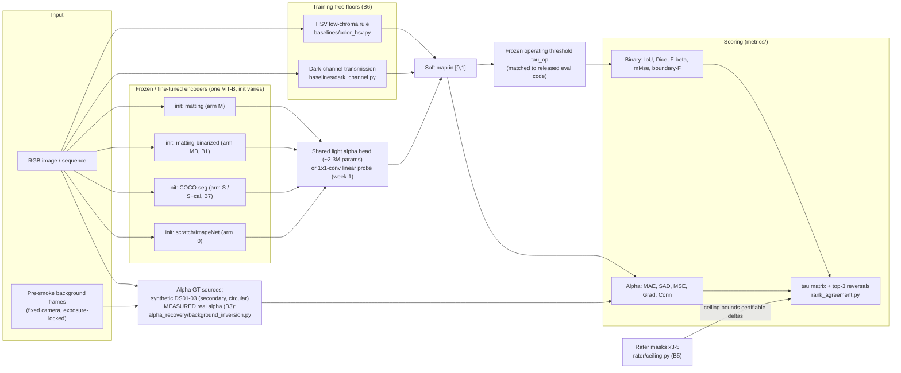

# AlphaSmoke — architecture-level diagram

Companion diagrams: full experiment overview in `../proposal.md` §6; pre-registered
decision tree in `../experiments.md` §3.

Scope guard (B10): no fire/smoke detector appears anywhere in this graph — SAM-class
models enter only as scored checkpoints in automatic/grid-point mode.
