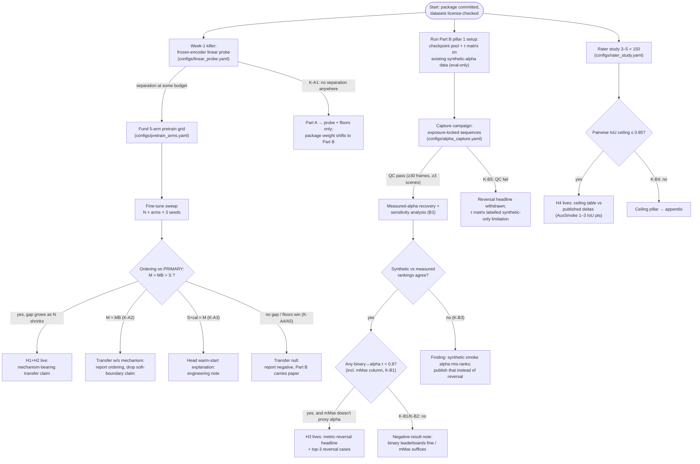

# AlphaSmoke — Pre-registered Experiment Plan (Stage 7)

Date: 2026-08-28 (UTC). Status: **PLAN — nothing here has been run.** Every number in
this file is a *budget, threshold, or prediction* (tagged), never a measurement. There
are no `ACTUAL EXPERIMENTAL RESULT` entries anywhere in this package.

Binding obligations B1–B10 are defined in `proposal.md` §2 and referenced throughout.

---

## 1. Pre-registered endpoints

### 1.1 Primary endpoint (B2)

**Real-smoke binary segmentation quality as a function of smoke fine-tune budget.**

- Datasets: SMOKE5K real test split (mandatory); AusSmoke/MultiNatSmoke real split
  (if license check in `datasets.md` passes).
- Metrics: mIoU (headline), boundary-F at 2-px tolerance; Fβ (β²=0.3) and mMse
  reported alongside for continuity with the SMOKE5K/FoSp protocol (B4).
- Unit of analysis: per-image scores, aggregated per arm × budget × seed; arms
  compared by mean ± bootstrap 95% CI over images, with seed as replication.
- Thresholding protocol: one fixed operating rule for all arms (per-image adaptive
  threshold as in the saliency/smoke convention **or** fixed 0.5 — final choice must
  match the released FoSp/SMOKE5K eval code and is frozen before any Part-A scoring;
  the verification note lives in `metrics_protocol.md` §2.3).

### 1.2 Secondary endpoint

Alpha metrics (MAE, SAD, MSE, Grad, Conn) on DS01–03 synthetic test splits.
**Printed caveat (verbatim in the paper):** synthetic alpha GT is produced by the same
compositing operation matting models are trained to invert; a matting-arm win here is
alignment with the benchmark's generative process, not evidence of transfer.

### 1.3 Tertiary endpoint (bridge to Part B)

Alpha-MAE on the measured-alpha real set (B3), restricted to pixels passing the
validity mask (saturation, conditioning, sensitivity — `metrics_protocol.md` §4).

### 1.4 Part-B endpoints

- τ matrix: sign-aligned Kendall τ for every metric pair over the checkpoint pool,
  with image-bootstrap CIs; top-3 reversal enumeration (B4).
- Measured-vs-synthetic ranking agreement: τ between checkpoint rankings under
  (a) synthetic alpha-MAE and (b) measured alpha-MAE.
- Rater ceiling: pairwise inter-rater IoU and alpha-MAE, per dataset, per density
  stratum (B5), confronted with published deltas.

## 2. Pre-registered decision thresholds (all fixed before any run)

| ID | Condition (evaluated on pre-registered endpoint) | Consequence |
|---|---|---|
| K-A1 | Week-1 probe: matting-encoder vs seg-encoder mIoU CIs overlap at **every** budget | Do not fund pretrain grid; Part A demotes to probe + floors |
| K-A2 | Arm M − Arm MB within seed noise at every budget | H2 (mechanism) dead; no soft-boundary claims |
| K-A3 | Arm S+cal ≈ Arm M at all budgets | Effect is head warm-start; H1 demoted to engineering note |
| K-A4 | M−S gap does not grow as N shrinks | Headline transfer claim withdrawn |
| K-A5 | No learned arm beats both physics floors at a budget | That budget reported floor-dominated |
| K-B1 | τ(mMse-on-binary, alpha-MAE-on-alpha) > 0.8 | Pillar 1 dies; field's existing metric vindicated |
| K-B2 | τ > 0.8 for all binary↔alpha pairs on synthetic **and** measured alpha | No reversal; publish negative-result note |
| K-B3 | Synthetic-alpha and measured-alpha rankings disagree (τ < 0.8 between them) | Reversal headline blocked; finding becomes "synthetic smoke alpha mis-ranks" |
| K-B4 | Rater pairwise IoU ceiling > 0.85 | H4 dead; ceiling pillar → appendix (B5) |
| K-B5 | Capture campaign yields < 30 QC-passing measured-alpha frames across ≥ 3 scenes | Reversal headline withdrawn per Set-C verdict; fallback per proposal §5.2 |

Threshold provenance: 0.8 τ and 0.85 IoU are carried unchanged from
`stage3_kill_medical_smoke.md` (§7, §8) and `stage4_r2_setC.md` (P096); they are not
tuned by us.

## 3. Decision tree (mermaid)

## 4. Runbook (dependency order; matches `stage6_battle.md` ordering discipline)

| Step | What | Depends on | Compute (PLAN estimate, not a result) |
|---|---|---|---|
| R0 | License/access audit of `datasets.md`; freeze thresholding protocol against released FoSp/SMOKE5K eval code | — | CPU-hours |
| R1 | Self-tests + metric cross-check of `src/alphasmoke` against any released eval code (mMse/Fβ definitional match) | R0 | CPU-hours |
| R2 | **Week-1 probe** (Part A §4.4): extract frozen features for both public encoders, train 1×1 probes, budgets × seeds | R1 | ≤ 1 GPU-day |
| R3 | Part B pillar 1 on synthetic alpha: run pool inference, compute metric tables + τ matrix | R1 | ≤ 2 GPU-days inference |
| R4 | Rater study launch (annotation is calendar-parallel to everything) | R0 | annotation cost, no GPU |
| R5 | Capture campaign + measured-alpha recovery + sensitivity maps | R1 | camera time + CPU |
| R6 | Controlled pretrains M / MB (+ matched-count S subsample cell) | R2 pass | ~2–4 GPU-days per arm (PLAN) |
| R7 | Fine-tune sweep arms × N × seeds + floors on every cell | R6 | ~5–10 GPU-days total (PLAN; small-data cells are cheap) |
| R8 | Re-run pool + Part-A arms on measured alpha; final τ matrix incl. mMse column | R3, R5, R7 | ≤ 1 GPU-day |
| R9 | Assemble ceiling confrontation table; write paper along decision-tree branch taken | R4, R8 | — |

Gate discipline: R6/R7 (the only training-heavy steps) are funded **only** if R2 shows
separation (K-A1), mirroring the P082-style gate used for Idea_02.

## 5. Statistical plan

- All arm comparisons: per-image paired bootstrap (10⁴ resamples) on the primary
  endpoint, seeds pooled as replicates; report CIs, never bare means.
- τ CIs: image-level bootstrap — resample images, recompute per-model means, recompute
  τ (implemented in `src/alphasmoke/metrics/rank_agreement.py::bootstrap_tau`).
- Rater ceiling: pairwise statistics over rater pairs × images; report per-stratum
  (density tercile) and pooled; dispersion across images shown, not just means.
- Multiple comparisons: the τ matrix is exploratory except the two pre-registered
  cells (K-B1 pair; synthetic-vs-measured agreement), which carry the confirmatory
  claims.
- Seed policy: 3 seeds minimum for any trained cell; no cell reported from 1 seed.

## 6. Out-of-scope guard (B10)

This project must not drift into detector-prompted fire/smoke segmentation:

- No fire/smoke detector produces prompts for any model in any experiment.
- SAM-class models appear only as *scored checkpoints* (automatic mask generation or
  fixed-grid point prompts, thresholded to soft maps), because Reviewer-2's S-126
  verdict folded detector-AP-matched attribution into the cluster-31 prompt-protocol
  project (`stage3_kill_medical_smoke.md` §10).
- Any result about prompt quality is out of scope and gets cut, not reported.

## 7. Legacy arm IDs (from the supervisor's initial Idea_03 skeleton)

| Skeleton ID | This plan |
|---|---|
| B0 (HSV/Otsu baseline) | Floors: HSV low-chroma + dark channel (§1.1 floors; K-A5) |
| P1 (frozen COCO/SAM encoder + linear) | Probe encoder `cocoseg_vitb` (R2) |
| P2 (frozen matting encoder + linear) | Probe encoder `matting_vitb` (R2) |
| P2b (binarized-matting control) | Arm MB in the pretrain grid (B1; R6–R7) |
| M (rank models Dice vs mMse) | Part B pillar 1 τ matrix incl. mMse column (R3, R8) |

## 8. What failure looks like (honest ledger)

Worst realistic outcome: probe null (K-A1) + no reversal (K-B2) + ceiling > 0.85
(K-B4) + capture QC fail (K-B5). Even then the package yields: a negative transfer
result with a mechanism-isolating design, a τ matrix showing binary metrics suffice
(useful to the field, quotable against the matting turn), and released tooling. That
outcome is a workshop-scale paper, not zero — but it is pre-registered here as the
floor so nobody re-narrates it as success.
