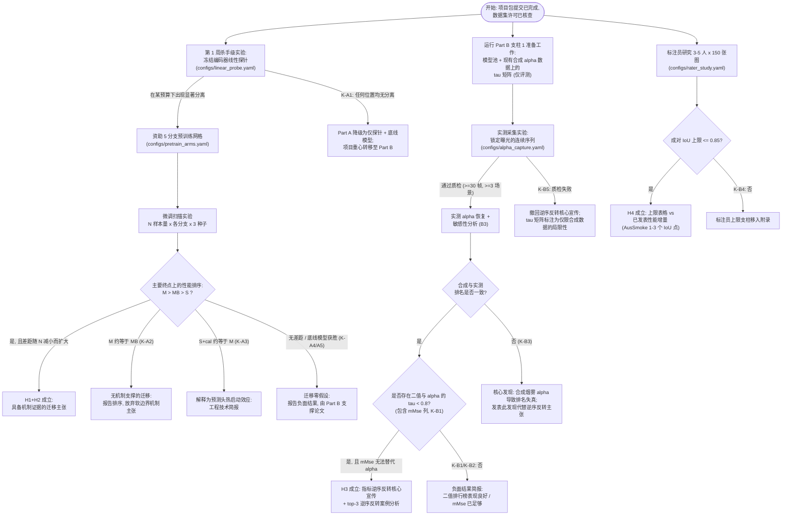

# AlphaSmoke — 预注册实验计划（Stage 7）

日期：2026-08-28 (UTC)。状态说明：**PLAN — 此处尚未运行任何实验。** 本文件中的每个数字均为*预算、阈值或预测*（均有明确标注），绝非实测数据。本包中任何位置均不存在 `ACTUAL EXPERIMENTAL RESULT` 标签。

具有约束力的既定义务 B1–B10 在 `proposal.md` §2 中定义并在全文中引用。

---

## 1. 预注册终点指标

### 1.1 主要终点（B2）

**真实烟雾二值分割质量与烟雾微调数据预算之间的函数关系。**

- 数据集：SMOKE5K 真实测试集划分（必须包含）；AusSmoke/MultiNatSmoke 真实划分（若 `datasets.md` 中的许可检查通过）。
- 指标：mIoU（主要宣传指标），2-px 容差下的 boundary-F；同时报告 Fβ（β²=0.3）和 mMse，以保持与 SMOKE5K/FoSp 评测协议的连续性（B4）。
- 分析单元：逐图像计算得分，按 分支 × 预算 × 随机种子 进行聚合；各分支通过在图像上的 均值 ± Bootstrap 95% 置信区间 进行对比，以随机种子作为复现实验。
- 阈值设定协议：所有分支采用单一固定的运行规则（如显著性/烟雾分割惯例中的逐图像自适应阈值，**或**固定 0.5 阈值 —— 最终选择必须与公开发布的 FoSp/SMOKE5K 评测代码保持严格一致，且在进行任何 Part-A 评分前冻结；验证记录见 `metrics_protocol.md` §2.3）。

### 1.2 次要终点

DS01–03 合成测试集划分上的 Alpha 指标（MAE, SAD, MSE, Grad, Conn）。
**印刷警告说明（在论文中字面打印）：** 合成 alpha GT 是通过与抠图模型训练所要反演的完全相同的图像合成操作生成的；抠图分支在此处取得胜利仅代表其与基准测试的生成过程对齐，不能作为有效迁移的证据。

### 1.3 第三终点（通往 Part B 的桥梁）

实测 alpha 真实测试集（B3）上的 Alpha-MAE，严格限制在通过有效性掩码（饱和度、病态条件、敏感性 — `metrics_protocol.md` §4）的像素范围内。

### 1.4 Part-B 终点指标

- τ 矩阵：模型池中每对评估指标之间符号对齐的 Kendall τ，附带图像级 Bootstrap 置信区间；枚举 top-3 逆序反转情况（B4）。
- 实测 vs 合成排名一致性：(a) 合成 alpha-MAE 与 (b) 实测 alpha-MAE 两种评测下模型排名之间的 Kendall τ。
- 标注员上限：按数据集、按烟雾密度分层测算的成对标注员间 IoU 与 alpha-MAE（B5），与已发表的性能差距进行直接对照。

## 2. 预注册决策阈值（在运行任何实验前全部固定）

| ID | 条件（在预注册终点指标上评估） | 触发后果 |
|---|---|---|
| K-A1 | 第 1 周探针：抠图编码器 vs 分割编码器的 mIoU 置信区间在**每个**预算下均重叠 | 不资助预训练网格；Part A 降级为仅报告探针 + 物理底线模型 |
| K-A2 | 分支 M − 分支 MB 的差距在每个预算下均处于随机种子噪声范围内 | H2（机制主张）终止；撤回关于软边界优势的主张 |
| K-A3 | 在所有预算下 分支 S+cal ≈ 分支 M | 该效应仅为预测头热启动；H1 降级为工程技术简报 |
| K-A4 | 随着 N 减小，M−S 之间的差距并未扩大 | 撤回核心迁移主张 |
| K-A5 | 在特定预算下没有任何可学习分支能够击败两种物理底线模型 | 该预算点被报告为“物理底线模型占主导” |
| K-B1 | τ(二值上的 mMse, alpha 上的 alpha-MAE) > 0.8 | 支柱 1 终止；表明该领域现有的评估指标已经足够有效 |
| K-B2 | 在合成**以及**实测 alpha 上，所有 二值↔alpha 指标对的 τ 均 > 0.8 | 未出现逆序反转；撰写负面结果简报 |
| K-B3 | 合成 alpha 与实测 alpha 的模型排名不一致（两者之间 τ < 0.8） | 逆序反转核心宣传被阻断；核心发现转为“合成烟雾 alpha 导致排名失真” |
| K-B4 | 标注员成对 IoU 上限 > 0.85 | H4 终止；标注员上限支柱移入附录（B5） |
| K-B5 | 采集实验在 ≥ 3 个场景中产出的通过质检的实测 alpha 帧数 < 30 帧 | 依据 Set-C 评审裁定撤回逆序反转核心宣传；按照提案 §5.2 执行回退方案 |

阈值溯源：0.8 τ 与 0.85 IoU 均直接继承自 `stage3_kill_medical_smoke.md`（§7, §8）和 `stage4_r2_setC.md`（P096），未经任何事后调整。

## 3. 决策树（Mermaid 图）

## 4. 运行手册（依依赖关系排序；严格遵守 `stage6_battle.md` 顺序纪律）

| 步骤 | 具体任务 | 依赖项 | 计算开销（PLAN 估算，非实测） |
|---|---|---|---|
| R0 | `datasets.md` 许可/获取状态核查；依据已发布的 FoSp/SMOKE5K 评测代码冻结运行阈值 | — | CPU 小时 |
| R1 | 自测试 + `src/alphasmoke` 依据已发布的评测代码进行指标交叉核对（mMse/Fβ 定义匹配） | R0 | CPU 小时 |
| R2 | **第 1 周探针**（Part A §4.4）：提取两个公开编码器的冻结特征，训练 1×1 探针，扫描预算 × 种子 | R1 | ≤ 1 GPU-day |
| R3 | 合成 alpha 上的 Part B 支柱 1：运行模型池推理，计算指标表 + τ 矩阵 | R1 | ≤ 2 GPU-days（仅推理） |
| R4 | 启动标注员研究（标注工作在时间线上与其他任务并行） | R0 | 标注人力成本，无需 GPU |
| R5 | 采集实验 + 实测 alpha 恢复 + 敏感性图谱构建 | R1 | 相机采集时间 + CPU |
| R6 | 受控预训练 M / MB（+ 样本量匹配的 S 子集单元格） | R2 判定通过 | 每分支约 2–4 GPU-days (PLAN) |
| R7 | 微调扫描：分支 × N × 种子 + 在每个单元格评测物理底线模型 | R6 | 共约 5–10 GPU-days (PLAN；小数据单元格极快) |
| R8 | 在实测 alpha 上重跑模型池 + Part-A 各分支；生成包含 mMse 列的最终 τ 矩阵 | R3, R5, R7 | ≤ 1 GPU-day |
| R9 | 整合标注员上限对照表；依据实际所走的决策树分支撰写论文 | R4, R8 | — |

关卡执行纪律：R6/R7（唯一的计算密集型训练步骤）**仅在** R2 展现出明确分离度时（K-A1）才予资助，与 Idea_02 所采用的 P082 风格关卡机制保持一致。

## 5. 统计分析计划

- 所有分支对比：在主要终点上进行逐图像配对 Bootstrap（10⁴ 次重采样），将不同随机种子作为重复实验进行汇总；始终报告置信区间，严禁仅报告孤立均值。
- τ 指标置信区间：图像级 Bootstrap —— 对图像集进行有放回重采样，重新计算每模型均值，重新计算 τ（实现于 `src/alphasmoke/metrics/rank_agreement.py::bootstrap_tau`）。
- 标注员上限：在 标注员对 × 图像 维度上计算成对统计量；按分层（密度三分位数）及全量分别报告；展示跨图像的分布离散情况，而非仅展示均值。
- 多重重采样对比：除两个预注册单元格（K-B1 对；合成 vs 实测一致性）承载证实性主张外，τ 矩阵其余部分均视为探索性分析。
- 随机种子策略：任何涉及训练的单元格至少使用 3 个随机种子；严禁报告仅基于单一种子的单元格结果。

## 6. 超出范围约束（B10）

本项目严禁向检测器提示的火灾/烟雾分割方向漂移：

- 在任何实验中，均不得由火灾/烟雾检测器为任何模型生成 prompt。
- SAM 类模型仅作为*被评估的 checkpoint*出现（自动掩码生成模式或固定网格点 prompt 模式，经阈值处理输出软掩码），因为 Reviewer #2 对 S-126 的评审裁定已将检测器 AP 匹配归因问题合并至 cluster-31 prompt 协议项目中（`stage3_kill_medical_smoke.md` §10）。
- 任何关于 prompt 质量的结果均属于超出范围，应予直接删去而非写入报告。

## 7. 遗留分支 ID 映射（源自主管最初的 Idea_03 骨架）

| 骨架 ID | 本计划中的对应设置 |
|---|---|
| B0 (HSV/Otsu 基线) | 底线模型：HSV 低饱和度 + 暗通道先验（§1.1 物理底线模型；K-A5） |
| P1 (冻结 COCO/SAM 编码器 + 线性探针) | 探针编码器 `cocoseg_vitb` (R2) |
| P2 (冻结抠图编码器 + 线性探针) | 探针编码器 `matting_vitb` (R2) |
| P2b (二值化抠图对照) | 预训练网格中的分支 MB（B1；R6–R7） |
| M (基于 Dice vs mMse 对模型排名) | 包含 mMse 列的 Part B 支柱 1 τ 矩阵（R3, R8） |

## 8. 失败形态预判（诚实总账）

最差的现实可能结果：探针无差异（K-A1）+ 指标无反转（K-B2）+ 标注上限 > 0.85（K-B4）+ 图像采集质检失败（K-B5）。即便如此，本项目包仍将产出：带有机制隔离设计的负面迁移结论、证明二值指标已足够有效的 τ 矩阵（对该领域极具价值，可作为反驳盲目转向抠图的引用论据）以及开源工具链。该结果足以支撑一篇 Workshop 级别的论文而非彻底归零 —— 但在此将其预注册为底线，严禁事后将其粉饰为全面成功。
