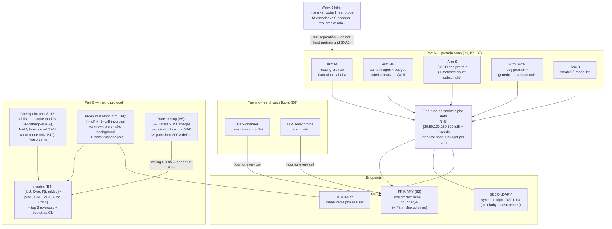

# Idea_03 — AlphaSmoke

**Matting-provenance transfer to smoke, and the metric protocol that makes the answer mean something.**

- **Window:** Windows4 · **Stage:** 7 (full package) · **Date:** 2026-08-28 (UTC)
- **Lineage:** P103 (S-103, matting→smoke transfer) + P096 (S-096 + S-102, smoke metric
  reversal + rater ceiling), merged per `selection_history/stage4_top20.md` (Top-5 item 3,
  Final-3 lock Idea_03) and `selection_history/stage6_battle.md`.
- **Reviewer-#2 provenance:** P103 verdict **WEAK ACCEPT (conditional)** in
  `stage4_r2_setA.md`; P096 verdict **SILENCED (measured-alpha arm mandatory)** in
  `stage4_r2_setC.md`. All binding conditions from both verdicts are adopted verbatim
  (§2) and wired into configs and code in this package.
- **Epistemic discipline (inherited from `supervisor_log.md`):** every claim below is
  tagged `KNOWN FACT` | `EVIDENCE` | `HYPOTHESIS` | `MODEL SPECULATION` |
  `EXPECTED RESULT` | `ACTUAL EXPERIMENTAL RESULT`. This package contains **zero**
  `ACTUAL EXPERIMENTAL RESULT` entries: no experiment has been run, no number below is
  a measurement. Citation tags follow the Stage-3/4 convention: `[V]` fetched and read
  during Stage 3/4 passes; `[S3]` carried from a Stage-3 file that claimed web
  verification; `[M]` memory-cited classic — re-verify the identifier before quoting in
  any draft.

---

## 0. One paragraph

Smoke has no hard boundary; its ground truth is a transmittance/alpha field, yet the
field mostly trains and ranks segmenters on binary masks. AlphaSmoke is one paper with
two coupled parts. **Part A (P103, the transfer bet):** does pretraining on
alpha-matting data (portrait/natural mattes) transfer to smoke better than
COCO-style binary-segmentation pretraining — with the *soft-label mechanism* isolated by
a binarized-matting control arm that keeps images and budget identical and destroys only
the label softness? **Part B (P096, the metric protocol):** is the field's leaderboard
ordering an artifact of binary metrics — measured as Kendall-τ rank agreement between
{IoU, Dice, Fβ, mMse} and {alpha-MAE, SAD, Grad, Conn} across a pool of published smoke
checkpoints, anchored by a **measured-alpha real test set** recovered by compositing
inversion against known pre-smoke backgrounds, and bounded by a multi-rater annotation
ceiling? Part B is not decoration: it is the instrument that makes Part A's endpoint
trustworthy, and it is independently publishable if Part A's transfer effect is null.

## 1. Hypotheses (falsifiable, pre-registered)

- **H1 (transfer, P103) — HYPOTHESIS.** At matched fine-tuning budgets and matched
  pretraining image counts, a matting-pretrained encoder outperforms a
  segmentation-pretrained encoder on **real-smoke** segmentation (primary endpoint,
  §4.3), and the gap **grows** as the smoke fine-tuning budget shrinks.
- **H2 (mechanism, P103) — HYPOTHESIS.** The advantage is caused by *soft-label
  structure*, not by matting-image provenance or head warm-start: the ordering
  `matting > matting-binarized > COCO-seg` holds on the primary endpoint. If
  `matting ≈ matting-binarized`, H2 is dead even if H1 holds — we report transfer
  without the soft-boundary mechanism and stop claiming the mechanism.
- **H3 (metric reversal, P096) — HYPOTHESIS.** Model rankings under binary-overlap
  metrics disagree with rankings under alpha-error metrics (Kendall τ < 0.8 for at
  least one binary/alpha metric pair, with top-3 reversal cases), **and** the
  disagreement replicates on measured real alpha, not only on synthetic composites.
- **H4 (rater ceiling, P096/S-102) — HYPOTHESIS.** Pairwise inter-rater IoU on standard
  RGB smoke benchmarks is low enough (< 0.85) that a non-trivial fraction of published
  SOTA deltas on those benchmarks fall below the annotation ceiling.

Named adversaries (who is wrong if we are right): if H1+H2 hold, "start from a
segmentation checkpoint" default practice for smoke is wrong and the matting turn
(SFMattingNet line) gets its missing justification; if H3 holds, binary-leaderboard
conclusions in smoke segmentation (including AusSmoke-scale 1–3-IoU-point SOTA deltas
`[V]`) are metric artifacts; if H3 fails with τ > 0.8 everywhere, the matting turn is
over-engineering and we publish that negative. If H4 holds, a further set of published
deltas is below the label noise floor (CoSW NeurIPS 2024 `[S3]` predicts this).

## 2. Binding obligations (Stage-4 verdict conditions — non-negotiable)

| # | Obligation | Source | Where implemented |
|---|---|---|---|
| B1 | **Binarized-matting pretrain arm** (same images, same budget, soft labels destroyed) | R2 Set A, P103 missing-baseline 1 | §4.1 arm MB; `configs/pretrain_arms.yaml` |
| B2 | **Real-smoke PRIMARY endpoint** (binary IoU + boundary-F on real smoke; sample-efficiency curves); synthetic alpha demoted to secondary with the circularity caveat printed | R2 Set A, P103 silencing experiment | §4.3; `configs/eval_protocol.yaml` |
| B3 | **Measured-alpha real arm** (compositing inversion against known backgrounds; exposure-locked; saturation-excluded; sensitivity analysis) | R2 Set C, P096 attack 3 — without it, P096 verdict flips to REJECT | §5.2; `src/alphasmoke/alpha_recovery/`; `configs/alpha_capture.yaml` |
| B4 | **mMse and Fβ columns** in the τ matrix (the field already reports mMse+Fβ on SMOKE5K — FoSp AAAI 2024 `[V]`); pre-registered kill: if τ(mMse-on-binary-GT, alpha-MAE-on-alpha-GT) > 0.8, pillar 1 dies | R2 Set C, P096 attack 1 | §5.1; `src/alphasmoke/metrics/`; `configs/eval_protocol.yaml` |
| B5 | **Rater-ceiling pillar with pre-registered demotion**: 3–5 raters × 150 images (SSD/SMOKE5K); if pairwise IoU ceiling > 0.85, demote to appendix | R2 Set C, P096 attack 4 | §5.3; `src/alphasmoke/rater/`; `configs/rater_study.yaml` |
| B6 | **Color/physics training-free baselines required**: dark-channel transmission floor + HSV/low-chroma color rule | Stage-3 S-103 killer experiment ("dark-channel transmission as training-free floor"); user Stage-7 binding | §4.2; `src/alphasmoke/baselines/` |
| B7 | **Head-alignment control**: segmentation-pretrain + brief alpha-head calibration on generic (non-smoke) composites | R2 Set A, P103 missing-baseline 2 | §4.1 arm S+cal |
| B8 | **Matched budgets / matched pretrain image counts** where feasible; matched-budget subsample of the segmentation corpus | R2 Set A, P103 missing-baseline 3 | §4.1; `configs/pretrain_arms.yaml` |
| B9 | **SFMattingNet in the checkpoint pool**; paper framed as the validity audit the matting turn skipped | R2 Set C, P096 attack 2 | §5.1 pool |
| B10 | **NOT a detector+SAM2 fire pipeline.** S-126 (detector-prompted fire SAM) was MUTATED into the prompt-distribution eval cluster and is out of scope (`stage3_kill_medical_smoke.md` §10, ProFSAM arXiv:2510.21782 `[S3]`). SAM appears here only as a *scored checkpoint* in the Part-B pool (automatic/point-prompt mode, thresholded), never as a fire/smoke system driven by a detector | Stage-3 §10; stage6 battle; user Stage-7 binding | §5.1 scope guard |

## 3. Background and prior work (why this is the surviving sliver)

All citations below appear in `stage3_kill_medical_smoke.md` or `stage4_r2_setC.md`
with the verification tag shown; none are new to this package.

- **KNOWN FACT / EVIDENCE.** Smoke density/transmittance regression is a published
  reformulation: Yuan et al., Deep Smoke Segmentation (Neurocomputing 2019 /
  arXiv:1809.00774 `[S3]`) built DS01–03 with **alpha-channel ground truth** via
  synthetic compositing; Yuan et al. (IEEE TIP 2020 `[S3]`) regress smoke density;
  Yan et al. (AAAI 2022 `[S3]`) use transmission as a physical guide and released
  SMOKE5K. The *ontology* claim ("smoke is a density field") is therefore dead
  (S-097 KILLED at Stage 3), and an alpha-head-on-SAM module is dead (A1-046 KILLED,
  Matting Anything arXiv:2306.05399 `[S3]`).
- **EVIDENCE (Stage-4 pass).** The field's SMOKE5K protocol already reports
  **mMse + Fβ** (FoSp, AAAI 2024, doi:10.1609/aaai.v38i7.28484 `[V]`); a 2026 binary
  benchmark (AusSmoke/MultiNatSmoke, arXiv:2604.23542 `[V]`) reports IoU/F1/MSE with
  SOTA deltas of 1–3 IoU points; trimap-free smoke-and-fire matting exists
  (SFMattingNet, Remote Sensing 17(13):2259, 2025, doi:10.3390/rs17132259 `[V]`).
  So "the field only uses binary overlap" is a strawman — the honest question, and the
  NOT-FOUND gap, is whether existing metrics **mis-rank** models, and whether the
  matting turn is *justified by evidence* rather than by taste.
- **EVIDENCE.** Smoke label noise / rater disagreement is established in principle:
  hyperspectral smoke dataset with 3 raters reports only 52.07% of smoke-marked pixels
  unanimous (arXiv:2602.10858 `[S3]`); CoSW (NeurIPS 2024 `[S3]`) treats label noise as
  intrinsic to smoke. NOT FOUND: the pairwise ceiling **on the standard RGB benchmarks**
  confronted with the published deltas on those same benchmarks (Stage-3 NOT-FOUND #6).
- **EVIDENCE (NOT FOUND register).** No controlled comparison of matting-pretrained vs
  segmentation-pretrained models on smoke exists (Stage-3 NOT-FOUND #7); MAM
  (arXiv:2306.05399 `[S3]`) never evaluated smoke; the Dice-vs-alpha rank-reversal
  study does not exist (Stage-3 NOT-FOUND #5).
- **KNOWN FACT.** Dark-channel prior (He, Sun & Tang, CVPR 2009 / TPAMI 2011 `[S3]`)
  gives a training-free transmission estimate for haze-like media — the physics floor
  every learned arm must beat (B6). Classical color-rule smoke detection (low chroma /
  grayness decision rules) is a decades-old family `[M — verify specific citation
  before drafting]`; we implement it as a rule-based control, not as a cited method.

## 4. Part A — the transfer experiment (P103)

### 4.1 Arms (identical architecture, init provenance is the only manipulated variable)

Architecture for all arms: one ViT-B (or equivalent mid-size) encoder + the same
lightweight alpha/mask regression head (MAM-style light head; ~2–3 M params
`[S3: arXiv:2306.05399]`). Head output is a single-channel soft map; binary endpoints
threshold it under the same protocol for every arm.

| Arm | Encoder init | Pretrain labels | Purpose |
|---|---|---|---|
| **M** | matting pretrain (P3M-10k + AIM-500 + Distinctions/Composition-class corpora `[M — dataset licenses §datasets.md]`) from a common ImageNet init | soft alpha | the bet |
| **MB** | *same images, same recipe, same budget* as M | alpha thresholded at 0.5 → binary | **B1**: isolates soft-label mechanism |
| **S** | COCO-seg pretrain (or public seg checkpoint at matched scale; plus a matched-image-count subsample cell per **B8**) | binary instance/semantic | field default |
| **S+cal** | arm S + brief alpha-head calibration on generic non-smoke composites | binary → alpha head warm-start | **B7**: kills the head-warm-start explanation |
| **0** | scratch / ImageNet-only | none | floor anchor |

Where a controlled pretrain is infeasible at full scale, the fallback (pre-registered)
is public checkpoints for M and S **plus** the matched-count controlled pretrain at
reduced scale; the headline claim then rests on the controlled cells, the public-ckpt
cells become supporting evidence.

### 4.2 Training-free floors (B6 — no learned arm is interpretable without them)

1. **Dark-channel transmission floor**: alpha ≈ 1 − t(x) under the single-scattering
   haze model (`src/alphasmoke/baselines/dark_channel.py`).
2. **HSV/low-chroma color rule**: smoke-likelihood from low saturation × mid/high value
   × low channel spread (`src/alphasmoke/baselines/color_hsv.py`).

Pre-registered relevance rule: at any fine-tune budget where a learned arm fails to
beat both floors on the primary endpoint, that arm's cell is reported as
"below physics floor" and excluded from transfer conclusions at that budget.

### 4.3 Endpoints

- **PRIMARY (B2): real smoke, binary metrics.** mIoU + boundary-F (plus Fβ and mMse
  columns for continuity with the field's protocol) on real-smoke test sets
  (SMOKE5K-real; AusSmoke/MultiNatSmoke if license permits), as **sample-efficiency
  curves** over smoke fine-tune budgets N ∈ {25, 50, 100, 250, 500, full} × ≥3 seeds.
- **SECONDARY (with printed circularity caveat):** alpha metrics (MAE/SAD/MSE/Grad/Conn)
  on DS01–03 synthetic composites. Caveat text (goes in the paper verbatim): synthetic
  alpha GT is produced by the same compositing operation matting pretraining inverts;
  matting-arm wins on this endpoint alone are uninterpretable as transfer.
- **TERTIARY (bridge to Part B):** alpha-MAE on the measured-alpha real set (§5.2) —
  the only endpoint that tests the soft-boundary mechanism on real smoke.

### 4.4 Week-1 killer (runs before any pretraining spend)

Per `stage6_battle.md` decisive-experiment list item 3: **frozen-encoder linear probe**
— matting-pretrained encoder vs COCO-seg encoder, identical 1×1-conv probe head trained
on limited real-smoke masks, report mIoU vs budget
(`src/alphasmoke/probes/encoder_linear_probe.py`, `configs/linear_probe.yaml`).
- **EXPECTED RESULT under H1 — this is a prediction, not a measurement:** the
  matting-pretrained encoder's probe mIoU exceeds the seg-pretrained encoder's at small
  N.
- Decision rule: if the probe shows **zero** separation at every budget (95% CI overlaps
  everywhere), the full four-arm pretrain grid is *not* funded; Part A demotes to the
  probe result + floors, and the package's center of mass shifts to Part B. This is the
  cheap-kill discipline from `evaluation_rubric.md`.

### 4.5 Part A kill conditions (pre-registered)

- K-A1: probe separation null at all budgets → do not fund pretrain grid (§4.4).
- K-A2: `matting ≈ matting-binarized` (difference within seed noise at every budget) →
  H2 dead; report provenance-transfer-without-mechanism; no soft-boundary claims.
- K-A3: `S+cal ≈ M` at all budgets → the effect is head warm-start; H1 reduced to an
  engineering note.
- K-A4: gap does **not** grow as N shrinks → "transfer" is generic capacity, headline
  claim withdrawn (ordering may still be reported as observed, labelled as such).
- K-A5: no learned arm beats the physics floors at low N → low-budget regime reported
  as floor-dominated; transfer claims restricted to budgets above the floor crossing.

## 5. Part B — the metric protocol (P096)

### 5.1 Pillar 1: rank agreement / reversal (τ matrix)

- **Checkpoint pool (target 8–12):** published smoke segmenters with released weights
  (SMOKE5K-family models incl. the Yan et al. AAAI 2022 line; FoSp `[V]` if weights
  public; SFMattingNet `[V]` per **B9**; Yuan et al. line if reproducible), MAM
  (`[S3]`), thresholded SAM in **automatic/point-prompt mode only** (scope guard
  **B10**: no fire/smoke detector anywhere in the loop, no detector-box prompting;
  the S-126 detector-matched fire question was folded into the cluster-31 prompt
  protocol and is not this paper), plus this package's Part-A arms.
- **Metric columns:** binary family {IoU, Dice, Fβ(β²=0.3), mMse-on-binary-GT} —
  **B4** makes mMse and Fβ first-class columns because the field already uses them
  (FoSp `[V]`); alpha family {MAE, SAD, MSE, Gradient, Connectivity} per the Rhemann
  et al. CVPR 2009 suite `[S3]`.
- **Statistic:** sign-aligned Kendall τ between every metric pair's model ranking
  (`src/alphasmoke/metrics/rank_agreement.py`), bootstrap CIs over images, plus
  explicit top-3 reversal enumeration.
- **Pre-registered kills (B4 + Stage-3):**
  - K-B1: τ(mMse-on-binary-GT, alpha-MAE-on-alpha-GT) > 0.8 → the field's existing
    metric already proxies alpha error; pillar 1 dies; FoSp's protocol is vindicated
    and we say so.
  - K-B2: τ > 0.8 for **all** binary↔alpha pairs on **both** synthetic and measured
    alpha → no reversal exists; publish as the negative-result note Stage 3 specified
    ("binary leaderboards are fine").

### 5.2 Pillar 2: measured-alpha real arm (B3 — mandatory)

Synthetic alpha GT is circular (R2 Set C attack 3). The escape is physics: on
fixed-camera sequences with clean pre-smoke background frames, the compositing
identity `I = αF + (1−α)B` has **two** unknowns per pixel (α and smoke color F); with
B known from pre-smoke frames and F estimated from dense-smoke regions, α is
recoverable by least squares across channels — no annotator, no synthesis
(`src/alphasmoke/alpha_recovery/background_inversion.py`).

- **Sources:** FIgLib-style fixed-tower sequences (Dewangan et al., Remote Sensing 2022
  `[S3]`) + a small lab capture campaign with locked exposure against calibrated
  backgrounds (`configs/alpha_capture.yaml`).
- **Controls (from the Set-C verdict, all binding):** exposure-locked sequences only;
  exclude saturated/backlit frames and ill-conditioned pixels (|F−B| below threshold);
  report sensitivity of recovered α to the smoke-color/single-scattering assumption by
  re-running recovery under perturbed F (implemented:
  `sensitivity_to_smoke_color()`).
- **Use:** rank the same checkpoint pool on (a) synthetic alpha, (b) measured real
  alpha, (c) binary GT. **The reversal claim survives only if (a) and (b) agree
  against (c).** If (a) and (b) disagree with each other, that indicts the synthetic
  data, and we report *that* — it is a publishable finding about DS0x-class corpora,
  pre-registered here as an acceptable outcome.
- **Fallback (user Stage-7 binding "if possible"):** if the capture campaign fails QC
  (insufficient exposure-locked sequences surviving exclusion), the reversal headline
  is withdrawn per the Set-C verdict (attack 3 stands); Part B demotes to
  (i) the τ matrix on synthetic alpha with the circularity caveat as a *labelled
  limitation*, and (ii) the rater ceiling; the paper's headline shifts to Part A. This
  fallback is a demotion path, not a rescue of the original claim.

### 5.3 Pillar 3: rater ceiling (B5) — and the rater-ceiling discussion

Protocol per Stage 3 / Set C: 3–5 raters × 150 images sampled from SMOKE5K-real and
SSD test splits (stratified by smoke density); binary masks and, on a subset, soft
scribble-derived alpha; compute pairwise inter-rater IoU and alpha-MAE ceilings
(`src/alphasmoke/rater/ceiling.py`), then overlay published SOTA deltas from the same
benchmarks (AusSmoke's 1–3-IoU-point deltas `[V]` are the concrete confrontation).

**Discussion the paper must contain (pre-committed):**

1. What the ceiling bounds: a pairwise-IoU ceiling of c means single-annotator GT
   cannot certify inter-model differences of order (1−c) in IoU; deltas below the
   ceiling are compatible with annotation noise (`EVIDENCE` for the general
   phenomenon: arXiv:2602.10858 `[S3]`; CoSW `[S3]`). It does **not** mean those
   models are equal — it means *these labels cannot tell*.
2. What it does not bound: multi-rater-consensus or measured-alpha evaluation can
   still separate models below the single-rater ceiling; the ceiling is an argument
   *for* the measured-alpha arm, not a nihilism license.
3. Ceiling as a function of the metric: the same rater pairs may have low IoU
   agreement but higher alpha-MAE agreement on soft regions (or vice versa) — the
   ceiling table is computed per metric, and metric choice changes how much published
   progress is certifiable.
4. **Pre-registered demotion (B5):** if pairwise IoU ceiling > 0.85, smoke labels are
   fine, H4 is dead, the pillar moves to an appendix, and only the metric-validity
   pillars stand.

### 5.4 Part B is eval-only

No training beyond Part-A arms. Cost: inference over ~10 checkpoints on public sets +
~300–750 rater-annotated images + one capture campaign. This matches the rubric's ROI
rules and the Set-C cost note ("eval-only … feasible").

## 6. System overview (mermaid)

## 7. Threats to validity

Every Stage-4 attack and its design answer is tabulated in
`reviewer_attacks.md`. The three residual risks no design fully removes:

1. **Scoop velocity** — the space around MAM applications moves fast (Stage-3
   confidence on S-103 was Medium for exactly this reason), and SFMattingNet shows the
   matting turn is underway. Mitigation: the week-1 probe and the eval-only Part B
   front-load the publishable core.
2. **Measured-alpha model error** — compositing inversion assumes a locally uniform
   smoke color and no multiple-scattering dominance; the sensitivity analysis bounds
   but does not eliminate this. The paper reports recovered-α uncertainty maps and
   excludes high-sensitivity pixels from scoring.
3. **Venue ceiling** — Set C: "evaluation-science paper for a small field; headline
   hostage to the τ matrix." Accepted; both τ outcomes are pre-registered as
   publishable (reversal, or negative-result note), and Part A gives the package a
   second, independent leg.

## 8. Deliverables

1. The AlphaSmoke paper (Part A + Part B, or the pre-registered demoted variants).
2. The measured-alpha real smoke test set + recovery code (release, license
   permitting).
3. The τ-matrix protocol + code as a reusable evaluation standard for soft-boundary
   segmentation.
4. Rater-ceiling tables for SMOKE5K/SSD with the confrontation against published
   deltas.

## 9. Package map

| Path | Content |
|---|---|
| `proposal.md` | this document |
| `experiments.md` | pre-registration: endpoints, decision tree (mermaid), runbook, budgets |
| `metrics_protocol.md` | exact metric definitions, τ protocol, ceiling method, alpha-recovery math |
| `datasets.md` | dataset inventory, access/license status (honest UNVERIFIED marks) |
| `reviewer_attacks.md` | R2 attack ledger → design answer, one row per attack |
| `literature.md`, `references/` | narrative literature notes; register lives in `CITATIONS.md` |
| `roadmap.md` | gate-ordered execution roadmap (mirrors the runbook) |
| `diagrams/architecture.md` | architecture-level mermaid (arms, probe, floors, scoring) |
| `CITATIONS.md` | citation register with `[V]`/`[S3]`/`[M]` tags |
| `src/alphasmoke/` | metrics (alpha, binary, rank agreement), baselines (HSV, dark channel), alpha recovery, linear-probe stub, rater ceiling |
| `configs/` | pretrain arms, datasets, eval protocol, linear probe, rater study, alpha capture |
| `tests/` | self-checks on synthetic arrays (unit tests, not experiments) |
| `requirements.txt` | pinned-range dependencies |
