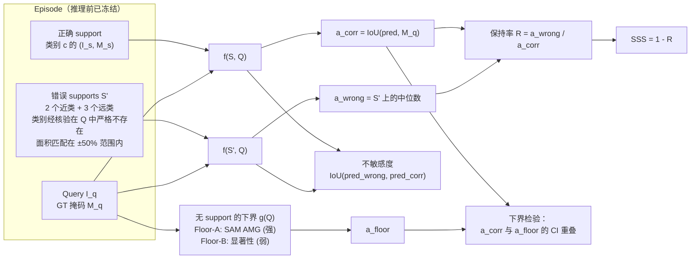
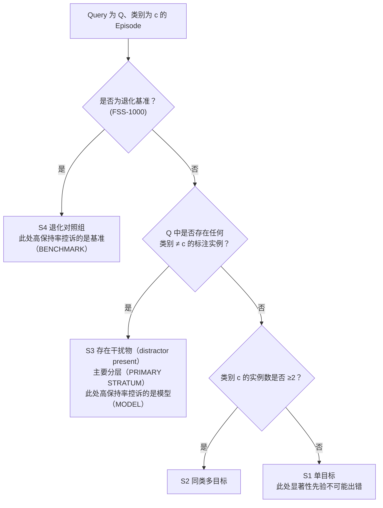
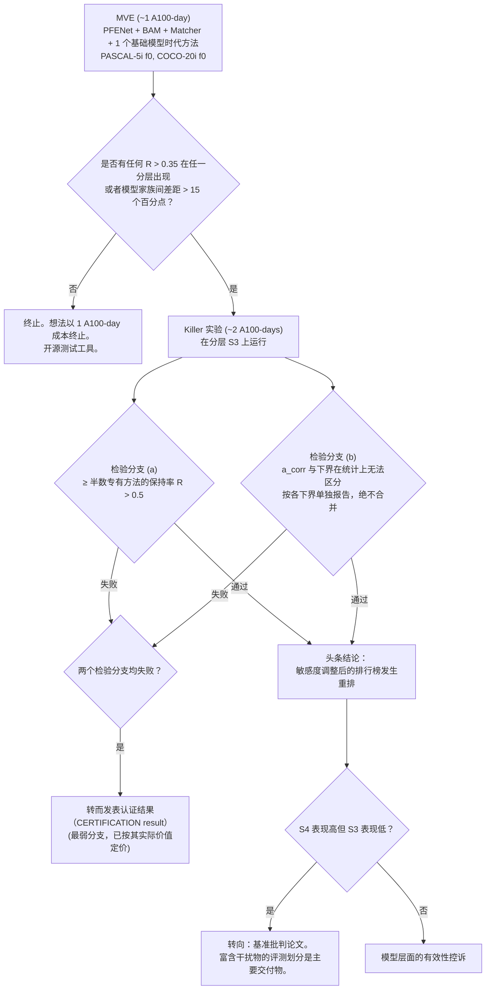
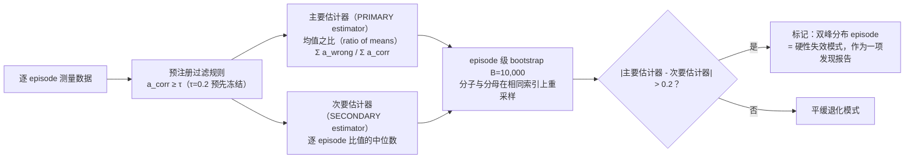

# Idea_01 — 协议与数据流（Protocol and Data Flow）

本项目中没有模型架构。此处的"架构"即测量装置本身，因此这些图表展示的是干预流程与决策规则，而非神经网络。

---

## 1. 逐 episode 的反事实干预

下界**针对每张 query 图像仅计算一次**，并在评测面板的所有方法间复用，这也是大部分算力节省的来源。

---

## 2. 分层（Stratification）—— 区分两种不同控诉的核心部分

`S3` 是主要分层，因为它是"分割显著物体"与"分割 support 指定的类别"被迫产生冲突的唯一分层。此前关于前景偏差的所有讨论都将 `S1` 与 `S3` 混为一谈；而本设计将其严格区分。

---

## 3. 决策规则

---

## 4. 统计分析流水线

**为什么主要估计器不能采用中位数。** 逐 episode 的保持率呈双峰分布：在错误 support 下，方法要么精准落在正确物体上，要么完全落空，因此 `R(e)` 会在 0 附近和 1 附近堆积。对这种分布取中位数等于抛硬币赌哪一堆更大。在原型运行中，完全由 support 驱动的对照组给出的中位数保持率为 1.000 —— 与无视 support 的方法完全一致 —— 而其均值之比为 0.762 [0.651, 0.871]。参见 `proposal.md` §10。
