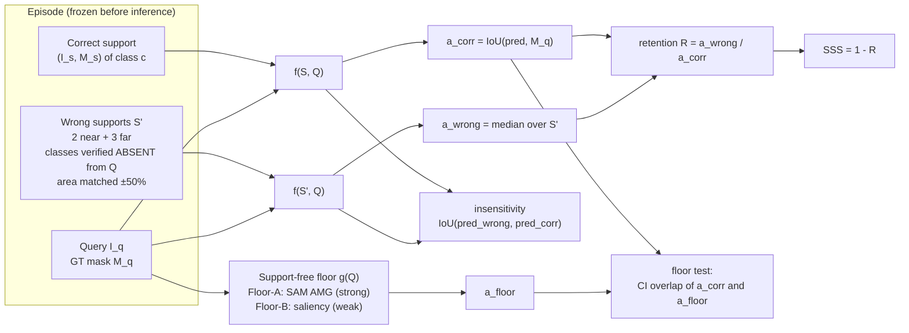
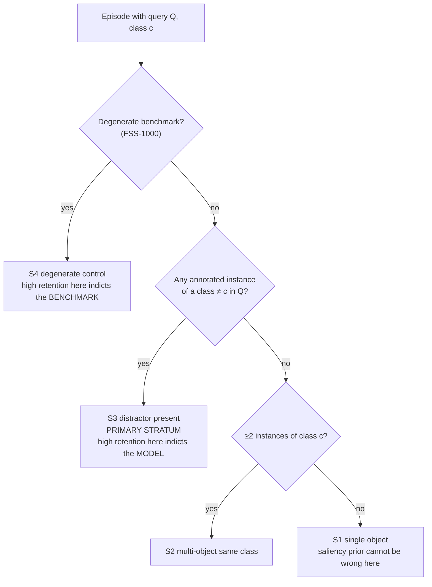
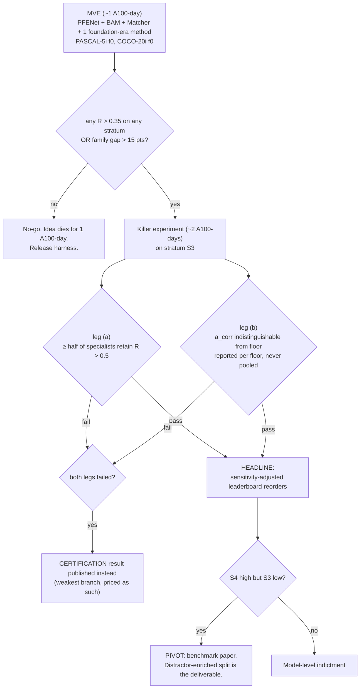
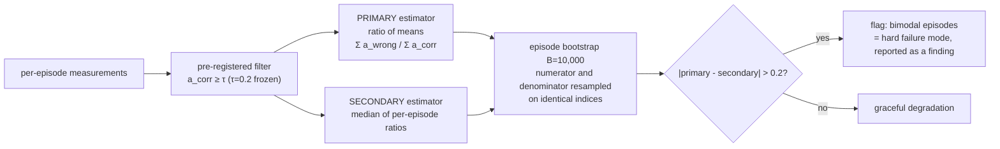

# Idea_01 — Protocol and Data Flow

There is no model architecture in this project. The "architecture" is the measurement apparatus,
so these diagrams show the intervention and the decision rule instead of a network.

---

## 1. The counterfactual, per episode

The floor is computed **once per query image** and reused across every method in the panel, which is
where most of the compute saving comes from.

---

## 2. Stratification — the part that separates two different indictments

`S3` is primary because it is the only stratum where "segment the salient thing" and "segment the
class the support names" are forced to disagree. Every prior discussion of foreground bias conflates
`S1` and `S3`; this design does not.

---

## 3. Decision rule

---

## 4. Statistics pipeline

**Why the primary estimator is not a median.** Per-episode retention is bimodal: under a wrong
support a method either lands on the correct object or it does not, so `R(e)` piles up near 0 and
near 1. A median over that distribution is a coin flip on which pile is larger. In the prototype run
the fully support-driven control scored median retention 1.000 — identical to a support-blind
method — while its ratio of means was 0.762 [0.651, 0.871]. See `proposal.md` §10.
