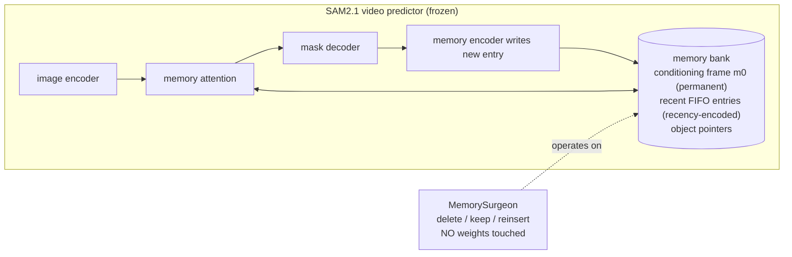
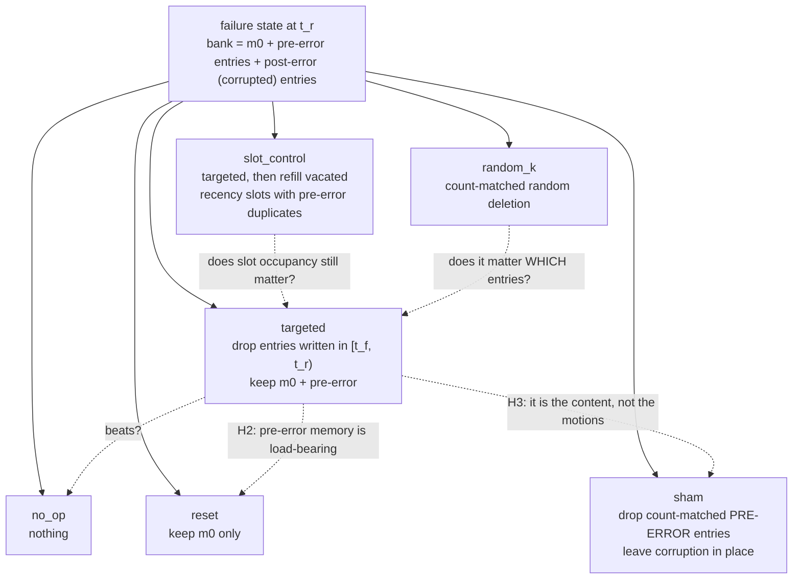
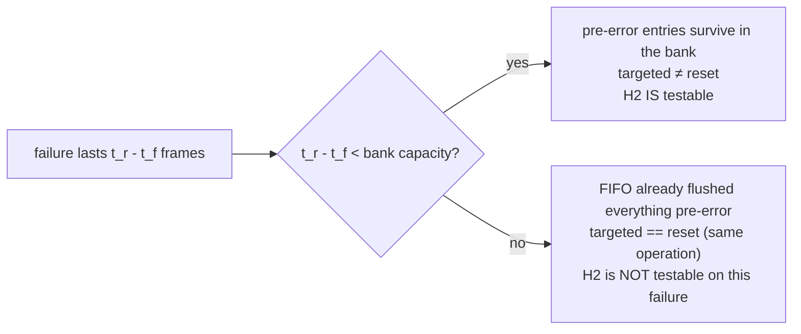
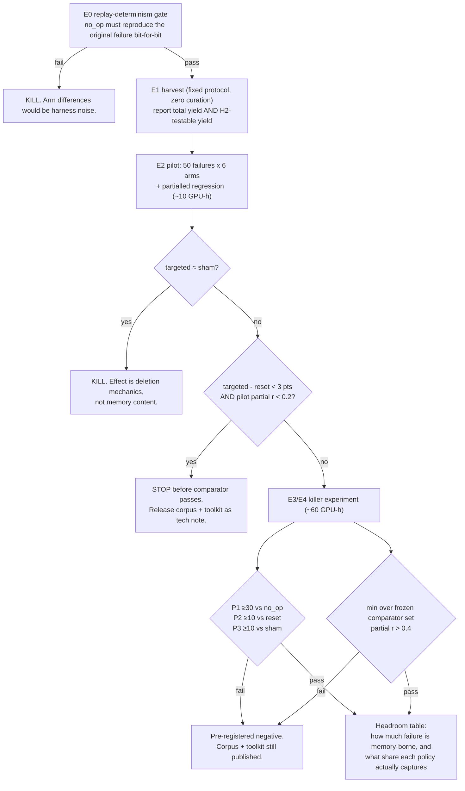
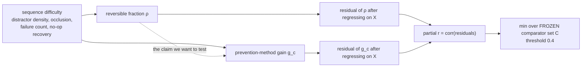

# Idea_02 — Surgery, Arms, and the Decision Rule

No weights are modified anywhere in this project. The "architecture" is a wrapper over SAM2's
inference-state memory bank plus the experimental design around it.

---

## 1. Where the surgeon sits

---

## 2. The six arms

`sham` is the vacuous control — same incision, nothing therapeutic removed. Implementing the
Stage-6 wording literally would have produced an arm that also removes the corruption, making
"targeted beats sham" unpassable by construction; that version is kept separately as `slot_control`.

---

## 3. The structural bound on H2

The share of the corpus on the left branch bounds how much of the harvest can speak to H2 at all. It
is reported at E1, before any P2 claim. In the prototype run it was 23 of 50 simulated failures.

**P2 is read on the left branch only.** Right-branch failures contribute an exact zero to the
`targeted − reset` gap, so pooling them dilutes a real effect rather than measuring a smaller one: in
the prototype a genuine +0.130 subset gap pooled to +0.040, below the pre-registered 0.10 bar, in the
world where the decomposition is real. The pooled figure is reported alongside and labelled diluted.

---

## 4. Decision rule

---

## 5. The validity design (attack A1)

Difficulty drives **both** `ρ` and `g_c`, so the naive correlation is inflated by a path that has
nothing to do with instrument validity. In the prototype, naive correlations of 0.952 / 0.918 /
0.859 became partial correlations of 0.682 / 0.397 / 0.028. Freezing `C` and reporting the minimum is
what prevents the 0.028 comparator from being dropped after the fact.
