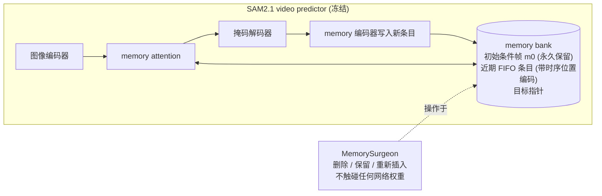
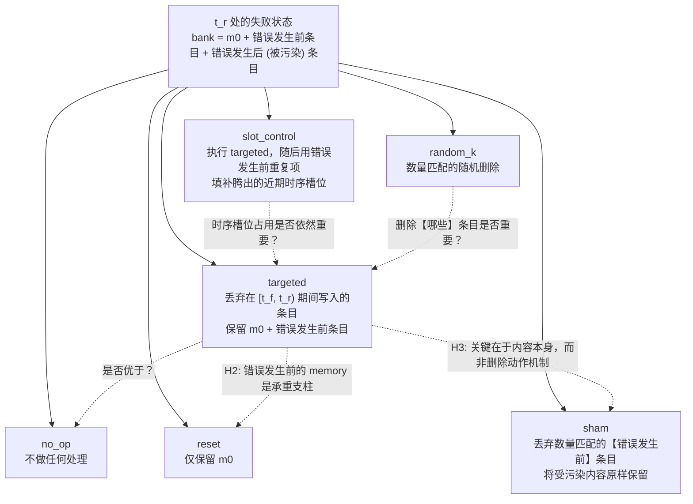
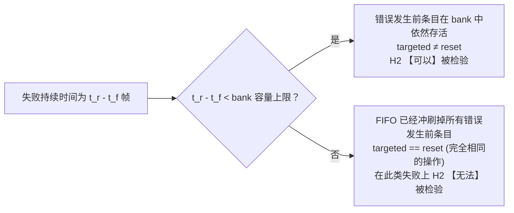
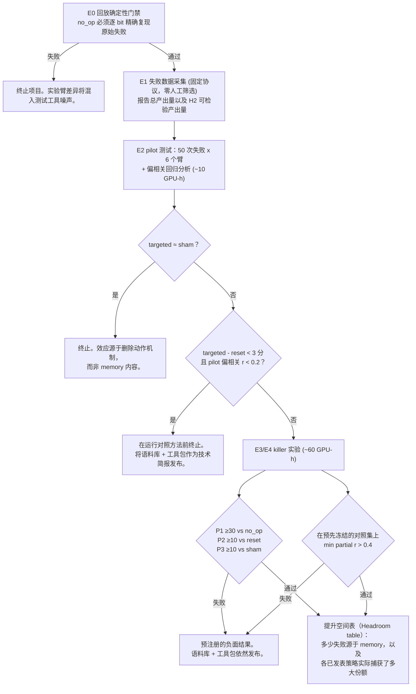
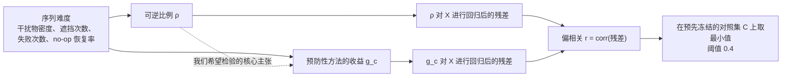

# Idea_02 — 手术方案、实验臂与决策规则（Surgery, Arms, and the Decision Rule）

本项目全程不修改任何网络权重。所谓的"架构"是对 SAM2 推理状态 memory bank 的包装封装，加上围绕其构建的实验设计。

---

## 1. 手术模块切入位置

---

## 2. 六个实验臂

`sham` 是无效对照 —— 进行完全相同的切口，但不移除任何具有治疗效果的内容。字面实现 Stage-6 的文字描述会产生一个同样移除了被污染内容的实验臂，导致"targeted 击败 sham"在构造上就是无法通过的；该版本单独保留为 `slot_control`。

---

## 3. H2 的结构性边界约束

语料库在左侧分支上的占比从结构上决定了数据采集能在多大程度上检验 H2。该指标在 E1 阶段、提出任何 P2 主张之前先行报告。在原型运行中，模拟的 50 次失败中有 23 次位于该分支。

**P2 仅在左侧分支上进行判定。** 右侧分支的失败对 `targeted − reset` 差距的贡献严格为零，因此合并它们会稀释真实效应而非测量到一个较小的效应：在原型中，原本子集上真实的 +0.130 差距在合并后被稀释至 +0.040（低于预注册的 0.10 门槛）。合并计算的数值会并列报告并明确标记为已被稀释。

---

## 4. 决策规则

---

## 5. 有效性设计（针对攻击点 A1）

难度同时驱动了 `ρ` 和 `g_c` **两者**，因此朴素的原始相关性被一条与工具测量有效性毫无关系的路径人为推高。在原型中，原始相关性分别为 0.952 / 0.918 / 0.859，在偏相关分析后变为 0.682 / 0.397 / 0.028。冻结对照集 `C` 并报告其最小值正是防止在事后悄悄剔除 0.028 对照方法的关键机制。
