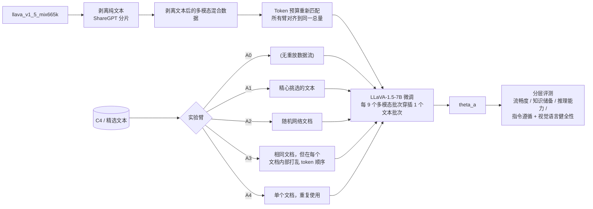
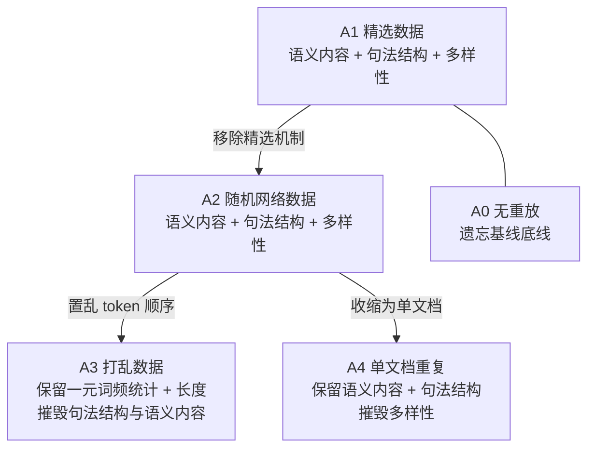
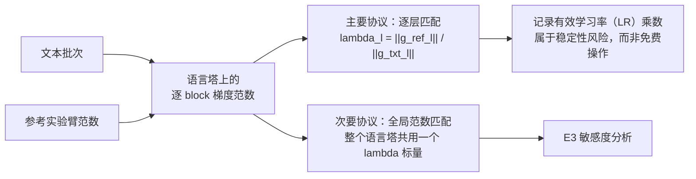
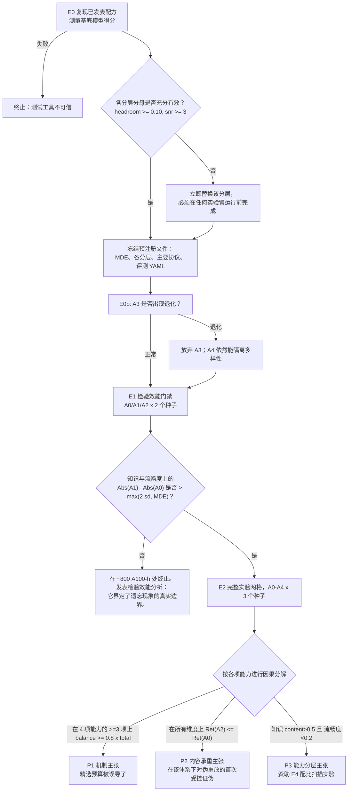

# Idea_03 — 实验网格、梯度匹配与门禁判定（The Grid, the Matching, and the Gate）

本项目不涉及新模型的构建。所谓的"架构"指的是实验设计体系：五个训练数据流、一种匹配约定，以及一套必须在任何训练运行前提交锁定的决策规则。

---

## 1. 训练流水线



`A0` 不包含重放数据流，因此需要抽取**更多**的多模态 token 来达到相同的总 token 预算。若缺少该重新匹配步骤，`A0` 仅仅是训练步数最短的实验臂，每个臂之间的差异都将被训练长度的混淆因素所污染。

---

## 2. 各实验臂摧毁的要素



`A3` vs `A2` 将句法结构与词汇统计特性隔离开来。`A4` vs `A2` 将多样性与语义内容隔离开来。这两个对比构成了核心贡献；仅凭 `A2` 只会产出模棱两可的结果。

---

## 3. 梯度匹配方案



逐层匹配被设定为主要协议，是因为模态特定的梯度在不同层之间可相差数个数量级（`arXiv:2606.17296`），导致全局标量即便报告完美匹配，各个独立 block 依然严重失配。预先指定主要协议可以避免在所有可能的世界中将"匹配约定出现分歧"都当作一项成果。

---

## 4. 门禁与决策规则



---

## 5. 效应分解体系

```
total-effect(c)   = Ret(c, A1) - Ret(c, A0)      重放所带来的总收益
balance-effect(c) = Ret(c, A2) - Ret(c, A0)      任何具备文本形态的梯度所带来的收益
content-effect(c) = Ret(c, A1) - Ret(c, A2)      精选机制所带来的收益
```

以绝对得分点（并列主要指标）和比率形式共同报告，附带跨随机种子的 bootstrap 置信区间。对于总效应低于声明 MDE 的任何能力，**不计算** `balance/total` 和 `content/total` 的份额比例：对效能分析判定为与零无显著差异的差距进行除法运算，产出的份额只会随着随机种子噪声大幅摆动。
