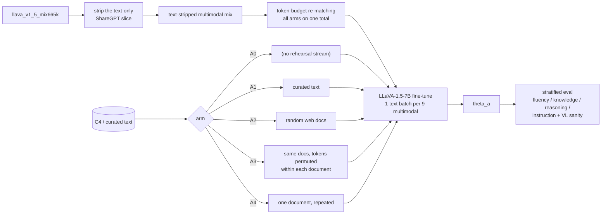
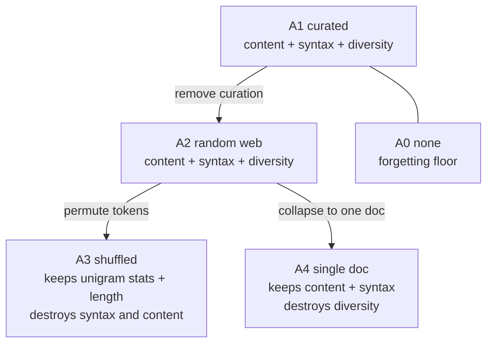
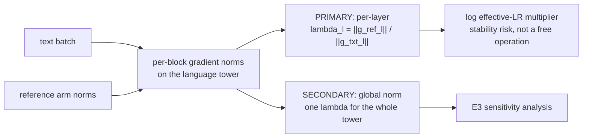
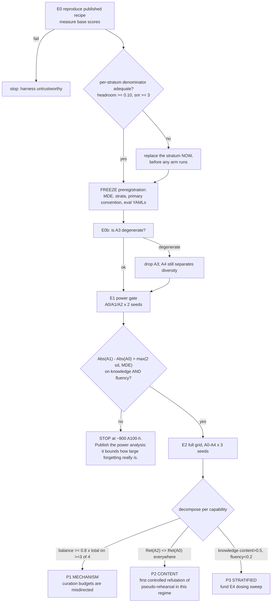

# Idea_03 — The Grid, the Matching, and the Gate

No new model. The "architecture" is the experimental design: five training streams, one matching
convention, and a decision rule that has to be committed before any of it runs.

---

## 1. The training pipeline



`A0` carries no rehearsal stream, so it draws **more** multimodal tokens to reach the same total.
Without that re-match, `A0` is simply the shortest run and every arm difference is contaminated by
training length.

---

## 2. What each arm destroys



`A3` vs `A2` isolates syntax from lexical statistics. `A4` vs `A2` isolates diversity from content.
These two contrasts are the contribution; `A2` alone would produce an ambiguous result.

---

## 3. Gradient matching



Per-layer is primary because modality-specific gradients differ by orders of magnitude across layers
(`arXiv:2606.17296`), so a global scalar can report a clean match while individual blocks remain badly
mismatched. Naming the primary in advance is what stops "the conventions diverged" from being a
result in every possible world.

---

## 4. Gates and the decision rule



---

## 5. The effect decomposition

```
total-effect(c)   = Ret(c, A1) - Ret(c, A0)      what rehearsal buys
balance-effect(c) = Ret(c, A2) - Ret(c, A0)      what ANY text-shaped gradient buys
content-effect(c) = Ret(c, A1) - Ret(c, A2)      what the curation buys
```

Reported in absolute score points (co-primary) as well as ratios, with bootstrap CIs over seeds. The
shares `balance/total` and `content/total` are **not computed** for any capability whose total effect
falls below the declared MDE: dividing by a gap the power analysis just called indistinguishable from
zero produces a share that swings on seed noise alone.
